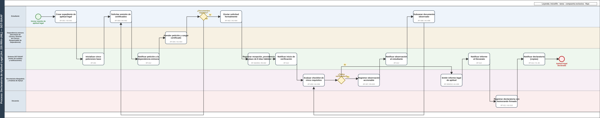

# Diagrama BPMN 2.0.2 — Declaratoria de Aptitud Legal (Art. 235 RRA-UNL)

**Análisis previo:** `ANALISIS_PROCESO.md`. **Fuente de los requisitos representados:** `sgt-siaaf/specs/001-tramite-titulacion/specify.md` §§8–10 (FL-01…FL-05, RF-001…RF-013). **Archivos fuente de este diagrama:** `diagramas/proceso_principal.bpmn` (XML BPMN 2.0.2 editable, con diagrama de interoperabilidad BPMNDI) y `diagramas/proceso_principal.svg` (representación visual derivada de las mismas coordenadas).

## 1. Vista del diagrama

*El diagrama es ancho (5 carriles × 20 elementos de flujo); en el portal Quarto se mostrará con desplazamiento horizontal (`overflow-x`). Para inspección detallada, abrir `diagramas/proceso_principal.svg` directamente o importar `diagramas/proceso_principal.bpmn` en un editor BPMN (por ejemplo, bpmn.io o Camunda Modeler).*

## 2. Participantes (carriles)

| Carril | Rol(es) reales | Nota |
|---|---|---|
| Estudiante | `ESTUDIANTE` | Inicia, completa documentación, subsana |
| Dependencia emisora | `SECRETARIA_CARRERA` / `DIRECTOR_CARRERA` / `RESPONSABLE_DEPENDENCIA` | Atiende peticiones internas; variante "estudiante carga directamente" no se grafica por separado (ver `ANALISIS_PROCESO.md` §2.1) |
| Sistema SGT-SIAAF | Motor de estados y notificaciones (backend) | Tareas 100% automáticas: inicialización, cálculo de plazo, numeración, notificaciones in-app |
| Secretario/a-Abogado/a y Analista de Apoyo | `SECRETARIO_ABOGADO` (decisión), `ANALISTA_APOYO` (apoyo) | Verificación y emisión del informe legal |
| Decano/a | `DECANO` | Cierre del proceso con la declaratoria |

## 3. Elementos del diagrama y trazabilidad

| Elemento BPMN | Nombre | Tipo | Requisito/HU de origen |
|---|---|---|---|
| `StartEvent_1` | Iniciar trámite de aptitud legal | Evento de inicio | Precondición de RF-001 |
| `Task_1` | Crear expediente de aptitud legal | Tarea | RF-001, HU-001 |
| `Task_2` | Inicializar cinco peticiones documentales base | Tarea (automática) | RF-001 |
| `Task_3` | Solicitar emisión de certificados a la dependencia | Tarea | RF-004, HU-002 |
| `Task_4` | Notificar petición a la dependencia emisora | Tarea (automática) | RF-012 |
| `Task_5` | Atender petición y cargar certificado | Tarea | RF-005, HU-003 |
| `Gateway_1` | ¿Los cinco documentos están vigentes? | Compuerta exclusiva | Validación interna previa a RF-002 |
| `Task_7` | Enviar solicitud formalmente | Tarea | RF-002, HU-004 |
| `Task_8` | Registrar recepción, asignar providencia y calcular plazo de 8 días hábiles | Tarea (automática) | RF-002, RF-003, RN-002, RN-010 |
| `Task_9` | Notificar inicio de verificación a Secretaría-Abogacía | Tarea (automática) | RF-012 |
| `Task_10` | Evaluar checklist de cinco requisitos | Tarea | RF-006, HU-006 |
| `Gateway_2` | ¿Todos los requisitos están verificados? | Compuerta exclusiva | RN-003, EX-007 |
| `Task_12` | Registrar observación accionable | Tarea | RF-007, HU-007, RN-003 |
| `Task_13` | Notificar observación al estudiante | Tarea (automática) | RF-012 |
| `Task_14` | Subsanar documento observado | Tarea | RF-008, HU-008, RN-011 |
| `Task_15` | Emitir informe legal de aptitud | Tarea | RF-009, RF-010, HU-009 |
| `Task_16` | Notificar informe emitido al Decanato | Tarea (automática) | RF-012 |
| `Task_17` | Registrar declaratoria de aptitud con memorando firmado | Tarea | RF-011, HU-010, RN-004 |
| `Task_18` | Notificar declaratoria a Secretaría-Abogacía, Director de Carrera y estudiante | Tarea (automática) | RF-012, FL-05 (postcondición) |
| `EndEvent_1` | Aptitud legal declarada | Evento de fin | Postcondición de RF-011/FL-05 |

## 4. Compuertas y bucles

- **Gateway_1** (`¿Los cinco documentos están vigentes?`): si falta un documento (**No**), el flujo regresa a `Task_3` (solicitar emisión) — bucle de completitud documental, el expediente permanece en `BORRADOR`.
- **Gateway_2** (`¿Todos los requisitos están verificados?`): si al menos un requisito está `OBSERVADO`/`PENDIENTE` (**No**), se activa el ciclo de observación (`Task_12`→`Task_13`→`Task_14`) que retorna a `Task_10` — corresponde a la alternancia real de estados `EN_VERIFICACION ⇄ OBSERVADA` del expediente. Si todos están `VERIFICADO` (**Sí**), continúa directamente a `Task_15` (emisión del informe).

Ambos bucles están verificados contra la máquina de estados real del backend (no son una suposición de modelado).

## 5. Notación utilizada

BPMN 2.0.2 estándar: evento de inicio (círculo verde, borde delgado), evento de fin (círculo rojo, borde grueso), tareas (rectángulo redondeado), compuerta exclusiva (diamante, X implícita por el patrón de dos salidas con condición), flujos de secuencia (flechas), pool único (el proceso completo de SGT-SIAAF) con 5 lanes (uno por participante). No se usan pools separados con flujos de mensaje porque todos los participantes operan dentro del mismo sistema (no hay intercambio de mensajes con un sistema externo en este proceso — el SGA y FirmaEC, ambos simulados, no participan en el flujo de Fase 1 según `specify.md`).

## 6. Limitaciones declaradas de este diagrama

1. No representa las excepciones técnicas (401, IDOR, 500 no mapeado) — están documentadas en `DOCUMENTACION/01_ESPECIFICACION/HISTORIAS_Y_CASOS_DE_USO.md` §2, no en el proceso de negocio.
2. No representa la variante "estudiante carga su propio certificado" como rama aparte (decisión de abstracción documentada en `ANALISIS_PROCESO.md` §2.1).
3. No representa los procesos de Fase 2/Fase 3 (sustentación, SENESCYT): no están implementados, y BPMN no debe usarse para presentar como proceso ejecutable algo que solo es diseño preliminar.
4. El diagrama fue construido por inspección directa de `specify.md` y `docs/auditoria/matriz-trazabilidad.md`; no deriva de ningún `.bpmn` previo porque no existía ninguno en el repositorio (hallazgo H-05 de la Fase 0 de esta auditoría).
