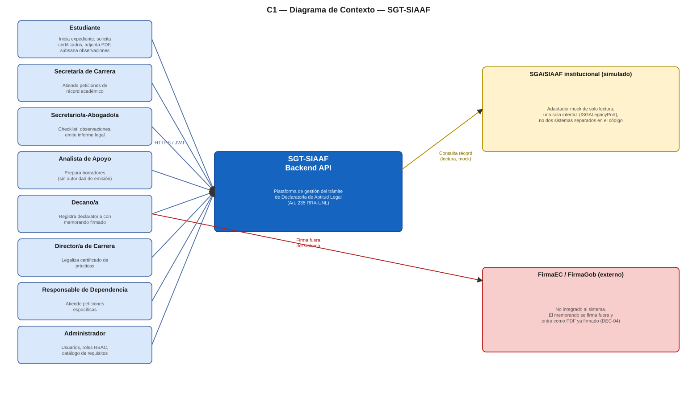

# C1 — Diagrama de Contexto — SGT-SIAAF

**Fuente del modelo:** `sgt-siaaf/specs/001-tramite-titulacion/specify.md` §6.1 (8 roles), `sgt-siaaf/specs/001-tramite-titulacion/plan.md` §8 (diagrama de contexto en Mermaid, usado como referencia de contenido), código real verificado (`backend/src/apps/authentication/adapters/models.py`, `core/ports/__init__.py`, `core/adapters/mock_sga.py`). **Fuente formal (Structurizr DSL):** `diagramas/workspace.dsl`, vista `C1_Contexto`. **Representación visual:** `diagramas/c1_contexto.svg`.

## Elementos

| Elemento | Tipo | Descripción |
|---|---|---|
| Estudiante, Secretaría de Carrera, Secretario/a-Abogado/a, Analista de Apoyo, Decano/a, Director/a de Carrera, Responsable de Dependencia, Administrador | Persona | Los 8 roles reales del sistema (`specify.md` §6.1, confirmados contra `authentication/adapters/models.py`) |
| SGT-SIAAF Backend API | Sistema | Alcance de este trabajo (incremento Fase 1) |
| SGA/SIAAF institucional (simulado) | Sistema externo | Fuente del récord académico; **corrección respecto a `plan.md`**: el plan original distingue SGA y SIAAF como dos sistemas externos separados, pero el código real solo implementa **una** interfaz (`ISGALegacyPort`) y **un** adaptador (`SGAMockAdapter`) — se representan como un único sistema externo simulado, fiel al código |
| FirmaEC / FirmaGob | Sistema externo, no integrado | El Decano/a firma el memorando fuera del sistema (DEC-04); no hay integración de API |

## Relaciones

Todos los roles acceden vía HTTPS/JWT a la API REST (`/api/v1/`). El sistema consulta el adaptador mock del SGA/SIAAF (solo lectura, sin escritura en bases legadas — Principio P-01/C-017). FirmaEC no tiene relación de integración con el sistema: el Decano/a la usa externamente y sube el resultado como PDF.

## Nota de fidelidad

Este diagrama corrige una imprecisión del `plan.md` original (que separaba SGA y SIAAF) para reflejar fielmente el código implementado, consistente con la regla de no presentar como sistema integrado algo que es una única simulación mock.
