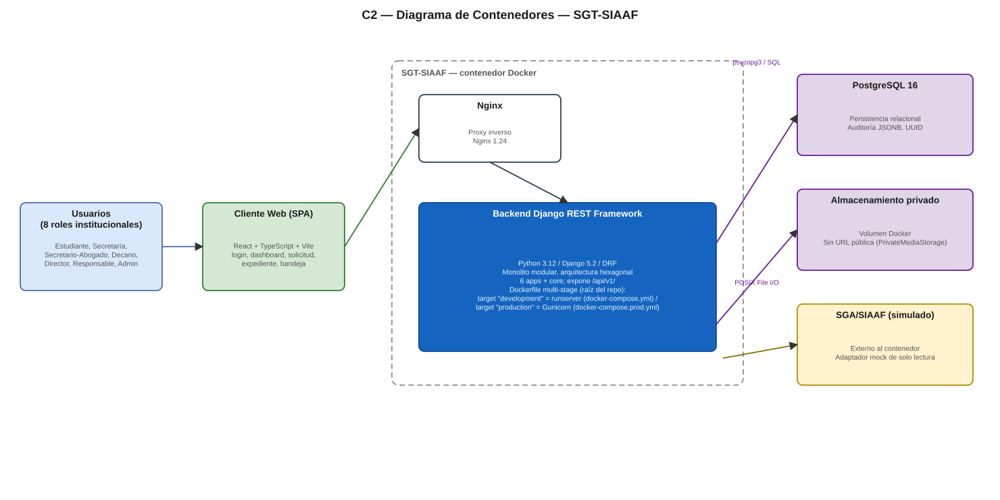

# C2 — Diagrama de Contenedores — SGT-SIAAF

**Fuente del modelo:** `plan.md` §9 (referencia de contenido), `docker-compose.yml`, `docker-compose.prod.yml`, `Dockerfile` (raíz del repositorio — **no** `backend/Dockerfile`, que no existe; corrección de una cita de ruta incorrecta en las Fases 0 y 3), `backend/entrypoint.sh`, `backend/requirements.txt`. **Fuente formal:** `diagramas/workspace.dsl`, vista `C2_Contenedores`. **Visual:** `diagramas/c2_contenedores.svg`.

> **Corrección de esta página (Fase 8, 2026-11-06):** la sección "Corrección de fidelidad" de abajo, escrita en la Fase 3, concluía que el contenedor backend "siempre sirve con Gunicorn, tanto en dev como en prod". **Esa conclusión era incorrecta** por una lectura incompleta del `Dockerfile`: no se había notado que es un Dockerfile **multi-stage** con dos targets independientes (`development` y `production`), cada uno con su propio `CMD`/`ENTRYPOINT`, y que `docker-compose.yml` (dev) usa `target: development` mientras que `docker-compose.prod.yml` usa `target: production`. La sección se mantiene abajo tachada conceptualmente y sustituida por el análisis correcto en `DOCUMENTACION/08_DESPLIEGUE/ARQUITECTURA_DOCKER.md` §2, que es ahora la fuente autoritativa sobre este punto. Se documenta el error aquí en vez de borrarlo silenciosamente, por transparencia del proceso de auditoría.

## Contenedores

| Contenedor | Tecnología | Responsabilidad | Verificación |
|---|---|---|---|
| Cliente Web (SPA) | React + TypeScript + Vite | Interfaz de usuario | `frontend/package.json`, confirmado |
| Nginx | Nginx 1.24 | Proxy inverso | `nginx/nginx.conf`, `nginx/prod.conf`, confirmado |
| Backend Django REST Framework | Python 3.12 / Django 5.2 / DRF | Monolito modular, lógica de negocio, API `/api/v1/` | Confirmado, 6 apps + core |
| PostgreSQL 16 | PostgreSQL 16 | Persistencia relacional + auditoría JSONB | `docker-compose.yml`, confirmado |
| Almacenamiento privado | Volumen Docker | PDF validados, sin URL pública | `core/adapters/local_storage.py` (`PrivateMediaStorage`), confirmado |

## [SUPERADO — ver corrección arriba] Análisis original de la Fase 3 (conservado por transparencia, no vigente)

~~Hallazgo verificado en esta fase (resuelve H-04 de la Fase 0): `backend/entrypoint.sh` ejecuta siempre `python manage.py migrate`, `collectstatic` y luego `exec gunicorn config.wsgi:application --workers 4`. El `ENTRYPOINT` del `Dockerfile` reemplaza completamente el proceso con Gunicorn; el `CMD` del mismo `Dockerfile` nunca se ejecuta... El contenedor backend siempre sirve con Gunicorn, tanto en dev como en prod.~~

**Por qué era incorrecto:** el `Dockerfile` real (en la raíz del repositorio) define **dos stages independientes** — `development` (sin `entrypoint.sh`, `CMD runserver`) y `production` (con `entrypoint.sh`, Gunicorn). `docker-compose.yml` construye con `target: development`; `docker-compose.prod.yml` con `target: production`. El `ENTRYPOINT` del stage `production` nunca convive con el `CMD` del stage `development` porque son imágenes distintas — no hay ninguna "sobreescritura" entre ellos. El análisis correcto está en `DOCUMENTACION/08_DESPLIEGUE/ARQUITECTURA_DOCKER.md` §2.

Este diagrama de contenedores no incluye un "PDF Generator Engine" como contenedor separado (a diferencia de `plan.md` §9, que lo dibuja como componente dentro del backend): en el código real, la generación de PDF (`ReportLab`, confirmado en `requirements.txt`) es una llamada en proceso dentro de la app `resoluciones`, no un servicio independiente — se representa correctamente como parte del contenedor "Backend Django REST Framework", detallado en el diagrama C3.
