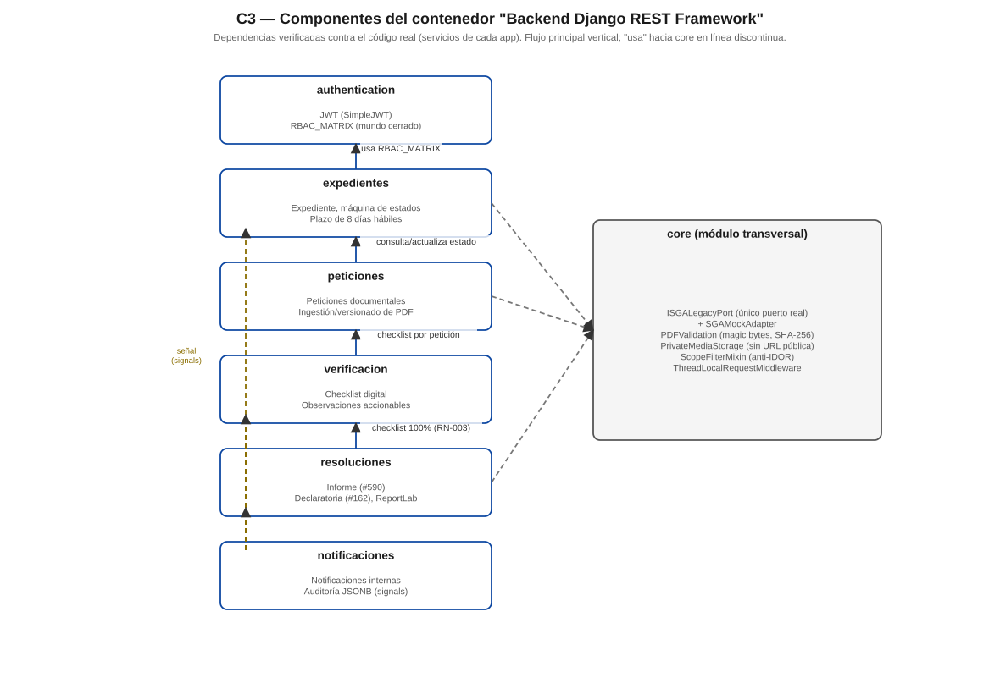

# C3 — Diagrama de Componentes — Backend Django (SGT-SIAAF)

**Fuente del modelo:** inspección directa del código (`backend/src/apps/*/`, `backend/src/core/`), `plan.md` §§10–11 (como referencia de intención de diseño, **no** copiada literalmente — ver nota de fidelidad). **Fuente formal:** `diagramas/workspace.dsl`, vista `C3_Componentes`. **Visual:** `diagramas/c3_componentes.svg`.

## Componentes (las 6 apps Django + el módulo transversal `core`)

| Componente | Responsabilidad | Depende de (verificado en servicios reales) |
|---|---|---|
| `authentication` | Usuarios, JWT (SimpleJWT), `RBAC_MATRIX` de mundo cerrado | Ninguno (núcleo) |
| `expedientes` | Expediente global, máquina de estados, plazo de 8 días hábiles | `authentication` |
| `peticiones` | Peticiones documentales, ingestión/versionado de PDF | `expedientes`, `authentication`, `core` |
| `verificacion` | Checklist digital, observaciones accionables, subsanación | `peticiones`, `expedientes` |
| `resoluciones` | Informe (#590), declaratoria (#162), generación PDF (ReportLab) | `verificacion`, `expedientes`, `core` |
| `notificaciones` | Notificaciones internas, bitácora de auditoría JSONB | Todos, vía Django signals |
| `core` | Módulo transversal: `ISGALegacyPort` + `SGAMockAdapter`, validación de PDF, almacenamiento privado, filtro de ámbito (anti-IDOR), middleware | Ninguno (es la base compartida) |

## Nota de fidelidad: la arquitectura hexagonal real es más simple que la planificada

`plan.md` §10 describe una arquitectura hexagonal con puertos de salida separados para cada necesidad de infraestructura (`IExpedienteRepository`, `IPDFStoragePort`, `ISGAIntegrationPort`, cada uno con su adaptador). **Se verificó en código (Fase 0 y Fase 3) que esto no es exactamente lo implementado:**

- `backend/src/core/ports/__init__.py` define **un único** puerto abstracto real: `ISGALegacyPort` (con `SGAMockAdapter` como única implementación).
- No existe un `IExpedienteRepository` ni un `IPDFStoragePort` como interfaces abstractas: los servicios de cada app (`backend/src/apps/*/services/*.py`) llaman directamente al ORM de Django (p. ej. `ExpedienteTitulacion.objects.select_for_update()` en `expedientes/services/crear_expediente.py`), sin una capa de repositorio intermedia.
- La carpeta `authentication/ports/` existe pero está vacía (sin clases).

Esto no invalida la arquitectura hexagonal declarada — el **dominio puro** (p. ej. `PlazoLaboralCalculator`, que no importa Django) y la **inversión de dependencias para el único caso que realmente lo necesita** (la integración con el SGA, mediante `ISGALegacyPort`) sí están implementados y verificados. Lo que se corrige es la fidelidad de la documentación: no se presenta como "implementado" un patrón de repositorio completo que no existe en el código. Esta es información verificable mediante `grep` directo, no una opinión.

## Relaciones omitidas del diagrama visual por claridad

El diagrama `c3_componentes.svg` simplifica el conjunto completo de relaciones (declaradas íntegramente en `diagramas/workspace.dsl`) para mantener legibilidad: se omiten visualmente las dependencias "salto" (p. ej. `peticiones -> authentication`, `resoluciones -> expedientes`) que no son la cadena principal; están documentadas en la tabla de arriba y en el archivo `.dsl`, que es la fuente completa.
