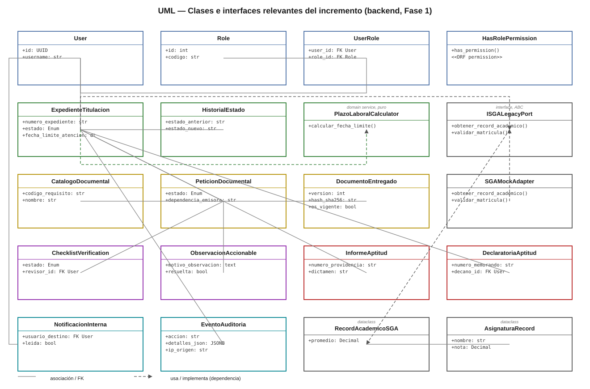

# UML — Clases e interfaces relevantes del incremento (backend, Fase 1)

**Fuente:** inspección directa del código real — `backend/src/apps/*/adapters/models.py` (nombres de clase exactos verificados por `grep`), `backend/src/apps/expedientes/domain/plazo_calculator.py`, `backend/src/core/ports/__init__.py`, `backend/src/core/adapters/mock_sga.py`, `backend/src/apps/authentication/adapters/permissions.py`. **Fuente formal (PlantUML):** `diagramas/clases_dominio.puml`. **Visual:** `diagramas/clases_dominio.svg` (sin renderizador PlantUML local disponible en este entorno; el SVG fue construido manualmente a partir de las mismas clases y relaciones del `.puml`, no es una captura automática — ver nota de verificación).

## Clases seleccionadas y justificación de la selección

Se seleccionaron las clases que representan directamente los RF-001 a RF-013 (ver `DOCUMENTACION/01_ESPECIFICACION/REQUISITOS_FUNCIONALES.md`), agrupadas por app:

| App | Clases/Interfaces | Nombre de archivo real |
|---|---|---|
| `authentication` | `User`, `Role`, `UserRole`, `HasRolePermission` | `adapters/models.py`, `adapters/permissions.py` |
| `expedientes` | `ExpedienteTitulacion`, `HistorialEstado`, `PlazoLaboralCalculator` | `adapters/models.py`, `domain/plazo_calculator.py` |
| `peticiones` | `CatalogoDocumental`, `PeticionDocumental`, `DocumentoEntregado` | `adapters/models.py` |
| `verificacion` | `ChecklistVerification`, `ObservacionAccionable` | `adapters/models.py` |
| `resoluciones` | `InformeAptitud`, `DeclaratoriaAptitud` | `adapters/models.py` |
| `notificaciones` | `NotificacionInterna`, `EventoAuditoria` | `adapters/models.py` |
| `core` | `ISGALegacyPort` (interfaz ABC), `SGAMockAdapter`, `RecordAcademicoSGA`, `AsignaturaRecord` | `ports/__init__.py`, `adapters/mock_sga.py` |

No se incluyen clases de Fase 2/3 (no implementadas) ni clases auxiliares de infraestructura sin relevancia de dominio (serializers, excepciones de validación), para mantener el diagrama centrado en lo que pide el encargo: "las clases e interfaces más relevantes del incremento".

## Relaciones principales

- **Herencia/implementación**: `SGAMockAdapter` implementa `ISGALegacyPort` (único puerto abstracto real del sistema, confirmado — ver `C3_COMPONENTES.md`, nota de fidelidad).
- **Asociaciones** (todas respaldadas por claves foráneas reales del modelo, visibles en `adapters/models.py`): `User 1--* UserRole`, `Role 1--* UserRole`, `User 1--* ExpedienteTitulacion`, `ExpedienteTitulacion 1--* PeticionDocumental`, `PeticionDocumental 1--* DocumentoEntregado`, `PeticionDocumental 1--0..1 ChecklistVerification`, `PeticionDocumental 1--* ObservacionAccionable`, `ExpedienteTitulacion 1--0..1 InformeAptitud`, `ExpedienteTitulacion 1--0..1 DeclaratoriaAptitud`, `ExpedienteTitulacion 1--* EventoAuditoria`, `User 1--* NotificacionInterna`.
- **Dependencias de uso** (no persistidas, llamadas de servicio): `ExpedienteTitulacion` usa `PlazoLaboralCalculator` (cómputo de plazo, RF-003) y consulta `ISGALegacyPort` (récord académico).

## Nota de verificación: diagrama construido sin renderizador PlantUML

Este entorno no tiene instalado un renderizador PlantUML (requiere Java + `plantuml.jar`, no presente ni descargado por no ser una fuente de confianza verificable sin conexión controlada). Para no dejar el diagrama solo como texto, se construyó un SVG equivalente a mano, validado como XML bien formado y revisado visualmente con Chrome headless (mismo método que en las Fases 2 y 3 para BPMN y C1/C2/C3), incluyendo una corrección de enrutamiento de líneas que inicialmente atravesaban texto de clases no relacionadas. El archivo `.puml` es la fuente editable y autoritativa: cualquier herramienta con soporte PlantUML (VS Code + extensión, `plantuml.jar`, servidores PlantUML en línea) puede renderizarlo de forma estándar.
