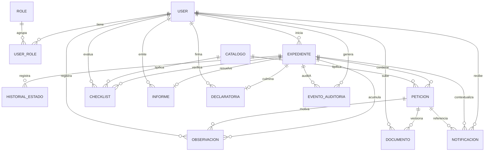

# Arquitectura de base de datos

## Motor y configuración

- **PostgreSQL 16** en producción/desarrollo (Docker, healthcheck `pg_isready`); SQLite en memoria para pruebas.
- `CONN_HEALTH_CHECKS=True` y `CONN_MAX_AGE` configurados; zona horaria UTC.

## Modelo de datos (14 tablas)

## Decisiones de modelado

| Decisión | Justificación |
|---|---|
| PK UUID en todas las entidades | No enumerabilidad; seguro en URLs |
| FK PROTECT hacia User y CatalogoDocumental | Impide borrados con historial (política de no borrado) |
| UniqueConstraint `(expediente, requisito)` en peticiones y checklist | Un requisito = una petición = una verificación por expediente |
| Versionado N+1 de documentos con `(peticion, version)` único y `es_vigente` | Historial completo de entregas sin perder versiones |
| OneToOne expediente↔informe y expediente↔declaratoria | La resolución es única e inmutable |
| `EventoAuditoria.detalles` JSONB | Bitácora flexible e inmutable (C-008) |
| Índices compuestos en consultas frecuentes | Bandeja, notificaciones, auditoría temporal |

## Integridad y migraciones

13 migraciones en 6 apps; `makemigrations --check` sin pendientes (verificado 05-11-2026). Semillas: catálogo Art. 235 (migración 0002 de peticiones) y usuarios demo (management command `seed_initial_data`, idempotente, no productivo).

## Limitaciones

- Sin estrategia de backups/restauración documentada.
- Sin particionamiento previsto para `EventoAuditoria` (crecimiento temporal).
- `carrera_id`/`facultad_id` son UUID sueltos (sin FK a catálogo institucional): los reportes por carrera requieren el catálogo BE-10.
