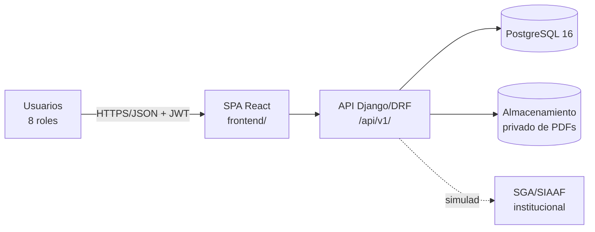

# Arquitectura general

## Visión de alto nivel

SGT-SIAAF es un **monolito modular con arquitectura hexagonal** en el backend y una **SPA** en el frontend, comunicadas por una API REST con JWT (ADR-0001, ADR-0002).

## Principios arquitectónicos

1. **Hexagonal**: dominio puro (`domain/`), casos de uso (`services/`), adaptadores Django (`adapters/`). La lógica de negocio no conoce HTTP ni ORM en su núcleo (p. ej. `PlazoLaboralCalculator`).
2. **Monolito modular**: cada app es un módulo con límites explícitos; `core` es infraestructura compartida que las apps consumen sin dependencias cruzadas entre apps de negocio.
3. **Mundo cerrado de permisos**: toda autorización pasa por la matriz RBAC; una celda vacía deniega.
4. **Transacciones íntegras**: todo caso de uso de escritura opera en `atomic` + `select_for_update` (Constitución C-009).
5. **Contrato primero**: el OpenAPI se genera del código (drf-spectacular) y se versiona en `backend/contracts/`.

## Componentes de despliegue (desarrollo)

| Componente | Tecnología | Puerto |
|---|---|---|
| Proxy | Nginx 1.24 | 8000 → 80 |
| Backend | Django 5.2 + DRF 3.16 (runserver en dev) | 8000 |
| Base de datos | PostgreSQL 16 | 5432 (interno) |
| Frontend | Vite dev server o build estático | 5173 (dev) |

## Flujo del trámite (mapeado a módulos)

| Paso | Actor | Módulo | Operación |
|---|---|---|---|
| 1. Crear solicitud | Estudiante | expedientes | `POST /expedientes/` |
| 2. Solicitar emisión de documento | Estudiante | peticiones | `POST /peticiones/{id}/solicitar-emision/` |
| 3. Cargar PDF | Estudiante/Secretaría | peticiones | `POST /peticiones/{id}/documento/` |
| 4. Enviar formalmente | Estudiante | expedientes | `POST /expedientes/{id}/enviar/` |
| 5. Evaluar checklist | Jurista | verificacion | `PUT /checklist/{id}/` |
| 6. Observar / subsanar | Jurista / Estudiante | verificacion | `POST /expedientes/{id}/observar/`, `POST /checklist/{id}/subsanar/` |
| 7. Emitir informe | Secretario Abogado | resoluciones | `POST /informes/` |
| 8. Declarar aptitud | Decano | resoluciones | `POST /declaratorias/` |
| Transversal | Todos | notificaciones | `GET /notificaciones/`, `PATCH /notificaciones/{id}/marcar-leida/` |
