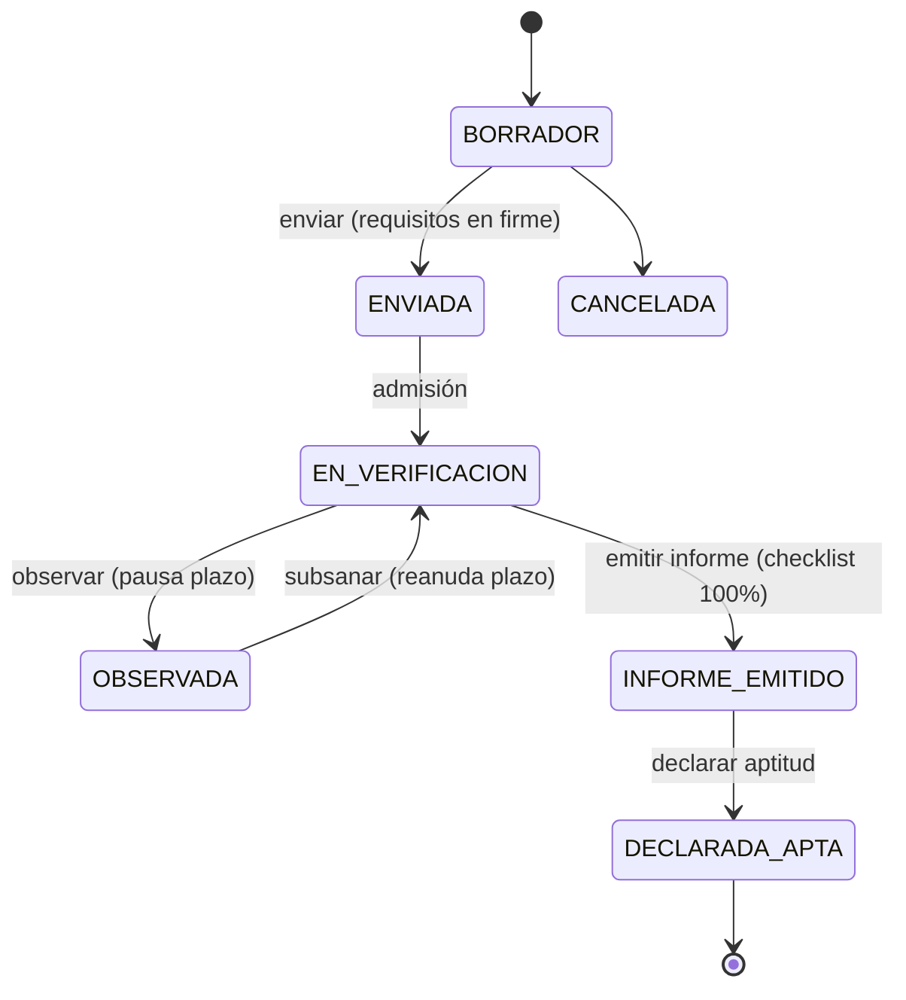

# C4 Nivel 4 — Estructuras de código representativas

Se documentan solo las estructuras que aportan valor de comprensión (no todas las clases).

## 1. Máquina de estados del expediente

```python
# apps/expedientes/adapters/models.py:22-30
ESTADOS_CHOICES = (
    ("BORRADOR", "Borrador"),
    ("ENVIADA", "Enviada"),
    ("EN_VERIFICACION", "En verificación"),
    ("OBSERVADA", "Observada"),
    ("INFORME_EMITIDO", "Informe emitido"),
    ("DECLARADA_APTA", "Declarada apta"),
    ("CANCELADA", "Cancelada"),
)
```

Transiciones legales (probadas en `test_expediente_state_machine.py`, 7 caminos):



## 2. Contrato del puerto SGA (dominio puro)

```python
# core/ports/__init__.py — resumen
@dataclass(frozen=True)
class AsignaturaRecord: ...      # código, nombre, créditos, calificación, estado
@dataclass(frozen=True)
class RecordAcademicoSGA: ...    # cédula, asignaturas, promedio_final (inmutable, RN-005)

class ISGALegacyPort(ABC):
    def obtener_record_academico(self, cedula: str) -> RecordAcademicoSGA: ...
```

Implementación única actual: `MockSGAAdapter` (fixture JSON de 5 récords, caché perezosa, sin conexiones reales).

## 3. Matriz RBAC (mundo cerrado)

```python
# apps/authentication/adapters/permissions.py:24-115 (extracto)
RBAC_MATRIX = {
    "expedientes": {
        "POST": {"ESTUDIANTE": {ALLOW}, "ADMINISTRADOR": {ALLOW}, ...},
        "GET":  {"ESTUDIANTE": {SCOPE_OWN}, "SECRETARIA_CARRERA": {SCOPE_CARRERA}, ...},
    },
    "checklist": {...},
    ...
}
# Celda vacía ⇒ DENY. HasRolePermission deniega si la vista no declara recurso.
```

## 4. Calculadora de plazos (dominio puro)

```python
# apps/expedientes/domain/plazo_calculator.py — API pública
class PlazoLaboralCalculator:
    def calcular_fecha_limite(inicio, dias=8) -> date      # cuenta desde el día hábil siguiente
    def pausar_reloj(hasta) -> None                        # idempotente
    def reanudar_reloj(hoy) -> None                        # extiende la fecha límite por días de pausa
```

No importa Django; está probada con 11 pruebas unitarias propias (feriados, fines de semana, acumulación).
