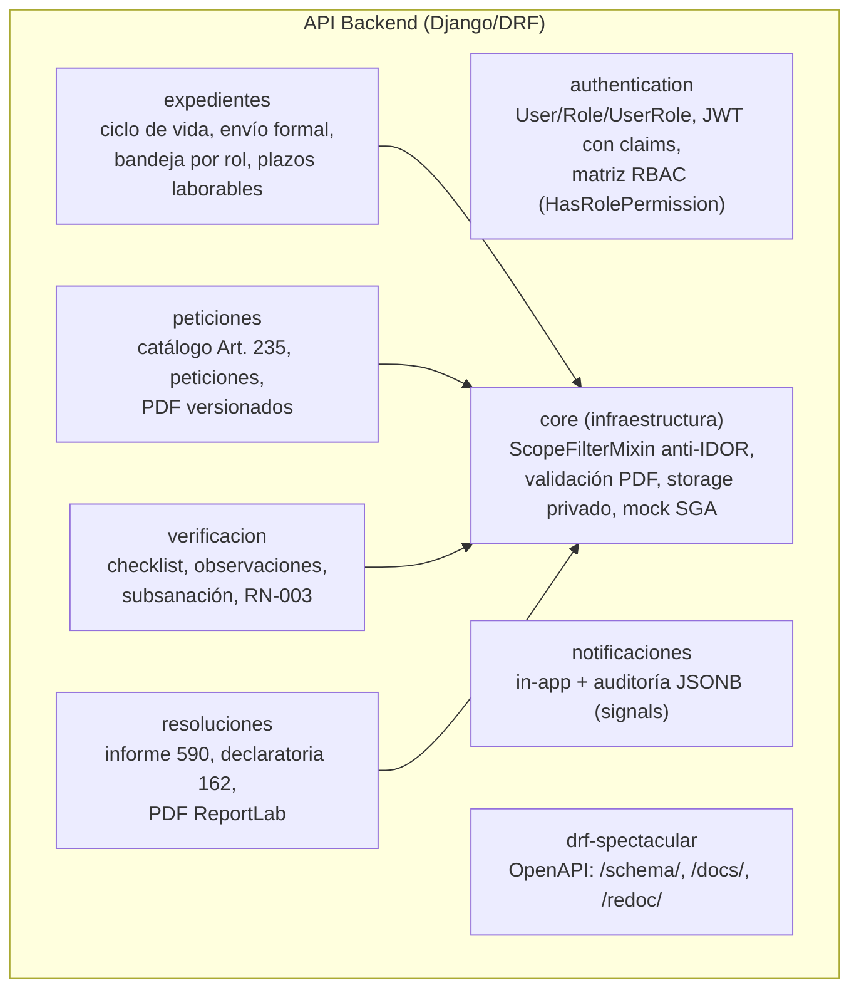

# C4 Nivel 3 — Componentes del backend

## Responsabilidades por componente

| Componente | Casos de uso (services/) | Reglas clave |
|---|---|---|
| authentication | login (vista directa) | Claims `cedula`+`roles`; matriz de mundo cerrado |
| expedientes | `crear_expediente`, `enviar_expediente`, `PlazoLaboralCalculator` | 1 expediente activo; 5 requisitos Art. 235; plazo 8 días hábiles con pausa/reanudación |
| peticiones | `solicitar_emision`, `cargar_documento` | PENDIENTE→SOLICITADO; PDF ≤10 MB con magic bytes y SHA-256; versionado N+1 |
| verificacion | `evaluar_checklist`, `registrar_observacion`, `subsanar_requisito`, `validar_checklist_completo` | Bloqueo pesimista; motivo obligatorio; pausa/reanudación del plazo; RN-003 |
| resoluciones | `emitir_informe`, `declarar_aptitud`, `PDFGeneratorAdapter` | Checklist 100 % VERIFICADO; rechazo NO APTO; numeración PROV-590/MEM-162 |
| notificaciones | `notification_service` (despacho sincrónico) | Notificación al actor correcto por evento; auditoría JSONB por signals |

## Componentes de indicadores

No existen aún. El diseño propuesto (capa `services/indicadores` + `GET /dashboard/me/`) está documentado en [Indicadores](../../07-indicadores/informe-kpi.md) y queda pendiente de autorización para implementarse.
