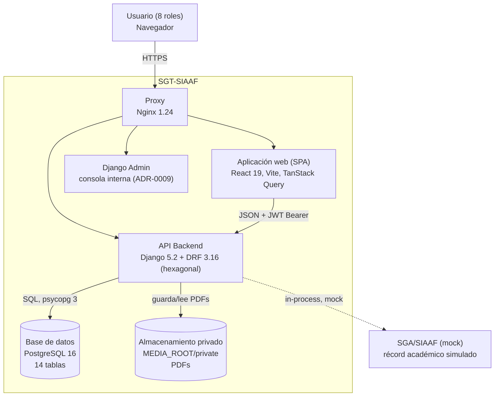

# C4 Nivel 2 — Diagrama de contenedores

## Descripción de contenedores

| Contenedor | Tecnología | Responsabilidad | Estado |
|---|---|---|---|
| SPA React | React 19, Vite, TanStack Query, react-router 7 | Presentación; 10 rutas oficiales con guards por rol | Andamiaje completo, vistas pendientes |
| API Backend | Django 5.2, DRF 3.16, SimpleJWT, drf-spectacular, ReportLab | 17 operaciones REST, máquina de estados, plazos, PDFs | Funcional y verificado |
| PostgreSQL 16 | psycopg 3, healthcheck incluido | Persistencia transaccional | Funcional |
| Almacenamiento privado | FileSystemStorage bajo `private/` | PDFs sin URL pública; descarga solo vía API autorizada | Funcional |
| Django Admin | contrib.admin | Soporte interno; 13 modelos read-only | Funcional |
| Nginx | 1.24-alpine | Punto de entrada único (puerto 8000) | Configurado para desarrollo |

**Nota de despliegue**: en el `docker-compose.yml` actual el backend corre con `runserver` y `DEBUG=1` por defecto: configuración de desarrollo (ver [Seguridad](../../06-seguridad/consideraciones-seguridad.md) y plan de mejora MEJ-P0-01).
