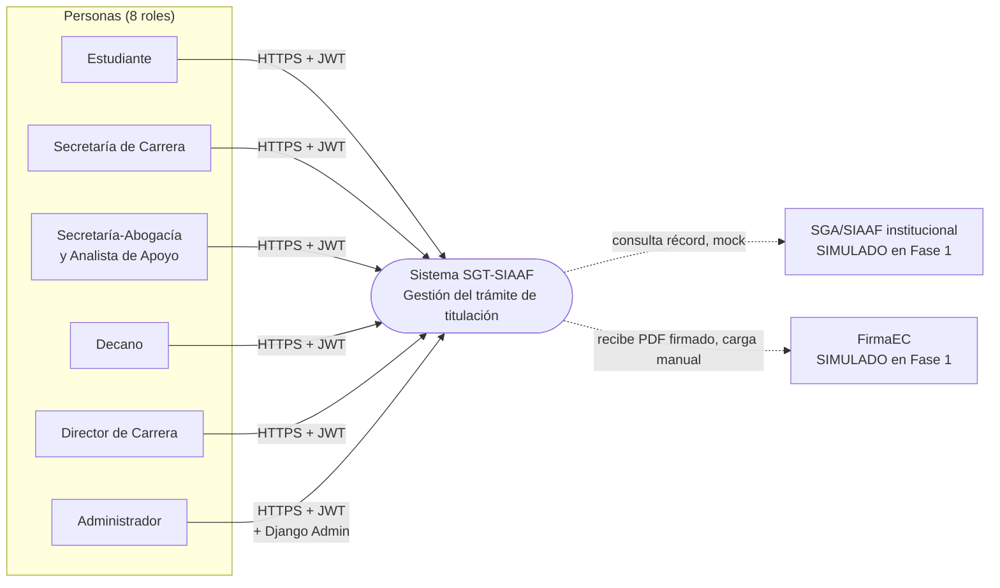

# C4 Nivel 1 — Diagrama de contexto

## Elementos

| Tipo | Elemento | Descripción |
|---|---|---|
| Personas | Estudiante, Secretaría de Carrera, Secretaría-Abogacía (con Analista), Decano, Director de Carrera, Administrador | Los 8 roles del código; `RESPONSABLE_DEPENDENCIA` actúa como dependencia emisora dentro del sistema |
| Sistema | SGT-SIAAF | Backend Django + SPA React (ver contenedores) |
| Sistemas externos | SGA/SIAAF, FirmaEC | **Simulados**: adaptador mock de solo lectura y carga manual del PDF firmado (DEC-04). Representarlos como integraciones activas sería falso |

## Límite del sistema

Todo lo demás (almacenamiento privado de PDFs, auditoría, notificaciones in-app, OpenAPI) es interno del sistema.
