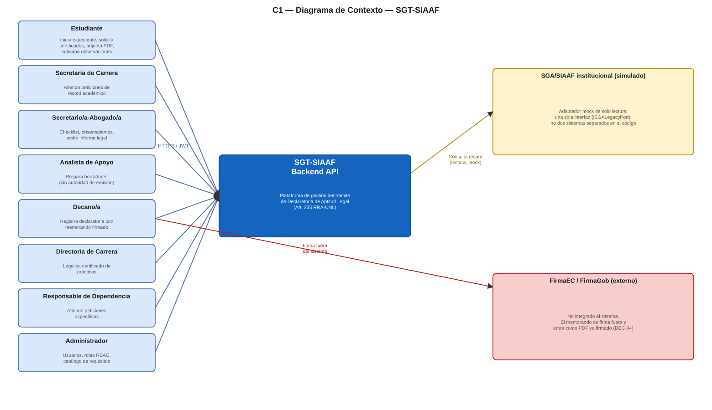
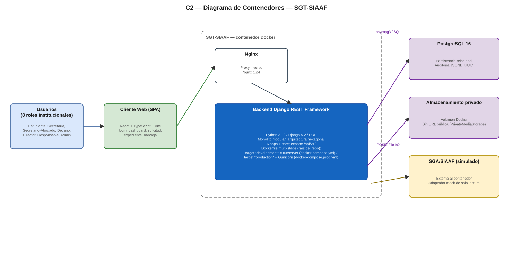
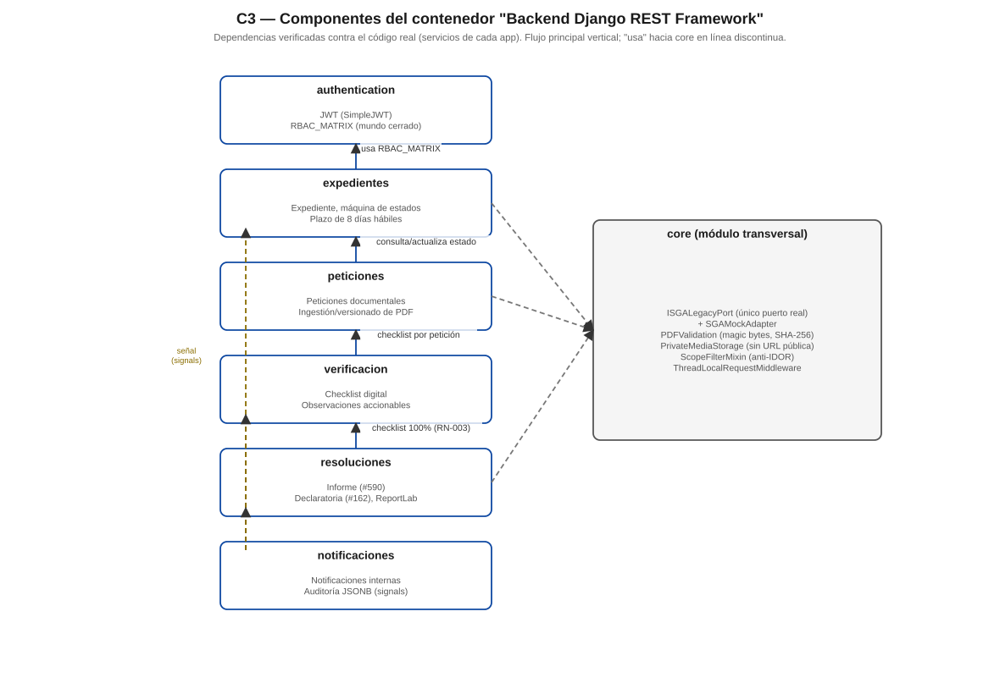
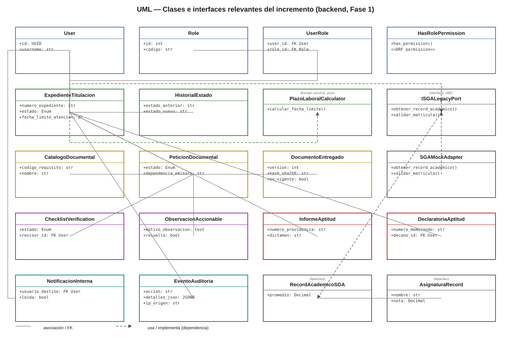

# Arquitectura C4 y UML — construidos desde cero

El capítulo [Arquitectura](../02-arquitectura/arquitectura-general.md) ya documenta C4 en Mermaid embebido. Esta sección añade lo que no existía: **fuentes formales Structurizr DSL y PlantUML**, con el modelo corregido contra el código real donde `plan.md` resultó idealizado.

## C1 — Contexto

::: {.column-screen-inset}

:::

**Corrección de fidelidad**: a diferencia de `plan.md` (que dibuja SGA y SIAAF como dos sistemas externos separados), el código real solo implementa **una** interfaz (`ISGALegacyPort`) y **un** adaptador mock — se representan como un único sistema externo simulado.

## C2 — Contenedores

::: {.column-screen-inset}

:::

**Hallazgo verificado en esta auditoría** (tras una autocorrección propia — ver `DOCUMENTACION/CONTROL_MAESTRO_DOCUMENTACION.md`, H-04): el `Dockerfile` (raíz del repositorio) es multi-stage. El compose de **desarrollo** (`docker-compose.yml`, por defecto) ejecuta `runserver`; solo el compose de **producción** (`docker-compose.prod.yml`) ejecuta Gunicorn. Detalle completo en `DOCUMENTACION/08_DESPLIEGUE/ARQUITECTURA_DOCKER.md`.

## C3 — Componentes

::: {.column-screen-inset}

:::

Las 6 apps Django + el módulo transversal `core`, con sus dependencias reales verificadas en los servicios (no solo las planificadas en `plan.md` — el proyecto solo implementa un puerto hexagonal real, `ISGALegacyPort`, no la batería completa de repositorios abstractos que describe el plan).

## UML de clases

::: {.column-screen-inset}

:::

Clases y relaciones verificadas por lectura directa de `adapters/models.py` en cada app (nombres de clase exactos, no conceptuales).

## Fuentes editables

- [`workspace.dsl`](assets/workspace.dsl) — Structurizr DSL (un workspace, 3 vistas: C1/C2/C3)
- [`clases_dominio.puml`](assets/clases_dominio.puml) — PlantUML

## Documentación completa

`DOCUMENTACION/03_ARQUITECTURA/{C1_CONTEXTO,C2_CONTENEDORES,C3_COMPONENTES,C4_UML,ADR}.md` — incluye las notas completas de fidelidad frente a `plan.md` y la consolidación de los 2 ADR reales del proyecto (`docs/adr/0001` y `0002`).
