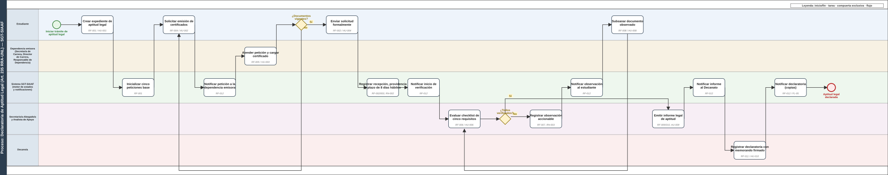

# Diagrama BPMN 2.0.2 — Declaratoria de Aptitud Legal

No existía ningún diagrama BPMN en el repositorio antes de esta auditoría (hallazgo H-05). El siguiente diagrama modela el proceso FL-01→FL-05 (`specify.md` §8), el único proceso del proyecto con implementación backend completa y verificada.

::: {.column-screen-inset}

:::

## Carriles (participantes)

5 carriles: Estudiante, Dependencia emisora (Secretaría de Carrera / Director de Carrera / Responsable de Dependencia), Sistema SGT-SIAAF (tareas automáticas), Secretario/a-Abogado/a y Analista de Apoyo, Decano/a.

## Elementos

20 elementos de flujo (2 eventos, 16 tareas, 2 compuertas exclusivas), 21 flujos de secuencia, incluyendo los dos bucles reales del proceso: completitud documental (antes del envío) y observación/subsanación (`EN_VERIFICACION ⇄ OBSERVADA`), ambos verificados contra la máquina de estados real del backend.

Cada tarea del diagrama está trazada a su requisito funcional de origen (RF-001 a RF-012) — el detalle completo de esa trazabilidad, el análisis previo al diagrama y las decisiones de abstracción están en `DOCUMENTACION/02_PROCESOS/{ANALISIS_PROCESO.md,DIAGRAMA_BPMN.md}`.

## Fuente editable

[`proceso_principal.bpmn`](assets/proceso_principal.bpmn) — XML BPMN 2.0.2 estándar con diagrama de interoperabilidad (BPMNDI), abrible en cualquier editor compatible (bpmn.io, Camunda Modeler).
