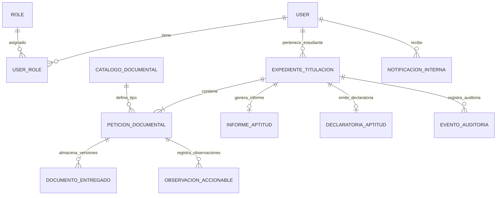

# INFORME TÉCNICO BACKEND — SGT-SIAAF

**Versión:** 1.0  
**Fecha:** 2026-11-05  
**Proyecto:** SGT-SIAAF — Sistema de Gestión del Trámite de Titulación Integrado al SIAAF (UNL)  
**Alcance:** Backend API (Fase 1 — MVP Aptitud Legal)  
**Estado:** Documentación técnica verificada contra código fuente real

---

## 1. Tecnologías y Versiones Verificadas

| Componente | Versión | Fuente |
|------------|---------|--------|
| Python | 3.12+ | `plan.md` §6.2, `Dockerfile` |
| Django | 5.x | `plan.md` §6.2, `requirements.txt` |
| Django REST Framework | 3.14+ | `requirements.txt`, `settings/base.py` |
| PostgreSQL | 16 | `plan.md` §6.2, `docker-compose.yml` |
| Driver DB | psycopg 3 | `requirements.txt` |
| Autenticación JWT | djangorestframework-simplejwt 5.x | `ADR-003`, `requirements.txt` |
| Documentación API | drf-spectacular | `requirements.txt`, `settings/base.py` |
| Validación PDF | Magic bytes + SHA-256 (custom) | `core/adapters/pdf_validation.py` |
| Almacenamiento | FileSystem (volumen privado) | `core/adapters/local_storage.py` |
| Contenerización | Docker / Docker Compose | `Dockerfile`, `docker-compose.yml` |
| Lint/Format | Flake8, Black, MyPy, Isort | `pyproject.toml`, `.flake8` |
| Pruebas | pytest, pytest-django | `pyproject.toml`, `requirements-dev.txt` |

**Evidencia:** `backend/requirements.txt`, `backend/pyproject.toml`, `backend/Dockerfile`, `backend/docker-compose.yml`, `backend/src/config/settings/base.py`

---

## 2. Estructura de Carpetas y Aplicaciones

```
backend/
├── Dockerfile
├── docker-compose.yml
├── manage.py
├── pyproject.toml
├── requirements.txt
├── requirements-dev.txt
├── .env.example
├── src/
│   ├── config/
│   │   ├── settings/
│   │   │   ├── base.py
│   │   │   ├── local.py
│   │   │   └── test.py
│   │   ├── urls.py
│   │   ├── wsgi.py
│   │   └── asgi.py
│   ├── core/
│   │   ├── domain/
│   │   ├── ports/
│   │   └── adapters/
│   │       ├── local_storage.py
│   │       ├── pdf_validation.py
│   │       └── mock_sga.py
│   └── apps/
│       ├── authentication/
│       ├── expedientes/
│       ├── peticiones/
│       ├── verificacion/
│       ├── resoluciones/
│       └── notificaciones/
```

**Evidencia:** `backend/src/` — estructura verificada en inspección directa.

### 6 Módulos Funcionales (Monolito Modular Hexagonal)

| Módulo | Responsabilidad Principal | Apps Django |
|--------|---------------------------|-------------|
| `authentication` | Usuarios, roles, JWT, matriz RBAC | `apps.authentication.adapters` |
| `expedientes` | Expediente global, motor de estados, plazos | `apps.expedientes.adapters` |
| `peticiones` | Peticiones documentales, ingestión PDF | `apps.peticiones.adapters` |
| `verificacion` | Checklist digital, observaciones, bloqueo informes | `apps.verificacion.adapters` |
| `resoluciones` | Borradores PDF, informe legal #590, declaratoria #162 | `apps.resoluciones.adapters` |
| `notificaciones` | Notificaciones in-app, bitácora auditoría | `apps.notificaciones.adapters` |

**Evidencia:** `backend/src/apps/` — 6 carpetas con estructura `domain/`, `services/`, `ports/`, `adapters/`.

---

## 3. Arquitectura y Responsabilidades por Capa

### Patrón: Monolito Modular + Arquitectura Hexagonal (Ports & Adapters)

**ADR-001** (Aceptado): `backend/docs/adr/0001-arquitectura-hexagonal-monolito-modular.md`

```
┌─────────────────────────────────────────────────────────────┐
│                    CAPA DE INFRAESTRUCTURA                   │
│  ┌─────────────┐  ┌─────────────┐  ┌─────────────────────┐  │
│  │  Cliente Web │  │ App Móvil   │  │ Swagger / OpenAPI   │  │
│  └──────┬──────┘  └──────┬──────┘  └──────────┬──────────┘  │
│         │               │                      │             │
│         └───────────────┼──────────────────────┘             │
│                         ▼                                    │
│        ┌──────────────────────────────┐                       │
│        │ REST API Adapters (DRF)      │                       │
│        └──────────────┬───────────────┘                       │
│                       ▼                                        │
│  ┌────────────────────────────────────────┐                   │
│  │         CAPA DE APLICACIÓN             │                   │
│  │  (Use Cases / Services)                │                   │
│  └────────────────┬──────────────────────┘                   │
│                   ▼                                           │
│  ┌────────────────────────────────────────┐                   │
│  │         NÚCLEO DE DOMINIO              │                   │
│  │  (Entities, Value Objects, Domain      │                   │
│  │   Services, RBAC Evaluator, PlazoCalc) │                   │
│  └────────────────┬──────────────────────┘                   │
│                   ▼                                           │
│  ┌────────────────────────────────────────┐                   │
│  │         PUERTOS DE SALIDA              │                   │
│  │  (Repository Ports, Storage Ports,     │                   │
│  │   SGA Legacy Port)                     │                   │
│  └────────────────┬──────────────────────┘                   │
│                   ▼                                           │
│  ┌──────────────┐ ┌──────────────┐ ┌────────────────────┐   │
│  │ Django ORM   │ │ Private FS   │ │ SGA Mock Adapter   │   │
│  │ Repository   │ │ Adapter      │ │ (JSON)             │   │
│  └──────────────┘ └──────────────┘ └────────────────────┘   │
└─────────────────────────────────────────────────────────────┘
```

### Reglas Inviolables de Dependencias

1. **Dominio agnóstico:** `src/<modulo>/domain/` — sin imports de Django/DRF/PostgreSQL
2. **Inversión de dependencias:** Capa de aplicación usa interfaces abstractas (`ports/`)
3. **Adaptadores periféricos:** DRF ViewSets, ORM, FileSystem, Mocks en `adapters/`

**Evidencia:** `backend/docs/adr/0001-arquitectura-hexagonal-monolito-modular.md`, `backend/src/apps/*/domain/`, `backend/src/apps/*/services/`, `backend/src/apps/*/ports/`, `backend/src/apps/*/adapters/`

---

## 4. Modelos y Relaciones Principales

### Diagrama ER (Verificado en Migraciones)



### Entidades Principales (Verificadas en `apps/*/adapters/models.py`)

| Entidad | Tabla | Clave PK | Campos Clave |
|---------|-------|----------|--------------|
| `User` | `authentication_user` | UUID | `cedula` (único), `carrera_id`, `facultad_id` |
| `Role` | `authentication_role` | UUID | `name` (enum 8 roles) |
| `UserRole` | `authentication_userrole` | UUID | FK User, FK Role |
| `ExpedienteTitulacion` | `expedientes_expedientetitulacion` | UUID | `numero_expediente` (único), `estado` (7 estados), `fecha_recepcion`, `fecha_limite_atencion`, `dias_laborables_acumulados` |
| `CatalogoDocumental` | `peticiones_catalogodocumental` | BigInt | `codigo_requisito` (único), `es_obligatorio_base`, `rol_emisor_sugerido` |
| `PeticionDocumental` | `peticiones_peticiondocumental` | UUID | `estado_peticion` (6 estados), `dependencia_emisora` |
| `DocumentoEntregado` | `peticiones_documentoentregado` | UUID | `version`, `archivo_path`, `hash_sha256`, `subido_por`, `es_vigente` |
| `ChecklistVerification` | `verificacion_checklistverification` | UUID | `estado_verificacion` (3 estados), `evaluado_por` |
| `ObservacionAccionable` | `verificacion_observacionaccionable` | UUID | `motivo_observacion`, `resuelta` |
| `InformeAptitud` | `resoluciones_informeaptitud` | UUID | `numero_providencia` (único), `dictamen`, `archivo_informe_path` |
| `DeclaratoriaAptitud` | `resoluciones_declaratoriaaptitud` | UUID | `numero_memorando` (único), `archivo_memorando_firmado_path` |
| `NotificacionInterna` | `notificaciones_notificacioninterna` | UUID | `usuario_destino`, `leida` |
| `EventoAuditoria` | `notificaciones_eventoauditoria` | UUID | `accion`, `rol_usuario`, `ip`, `detalles` (JSONB) |

**Evidencia:** Migraciones en `apps/*/adapters/migrations/`, modelos en `apps/*/adapters/models.py`

---

## 5. Endpoints Existentes y Funcionalidad

**Base:** `/api/v1/` — 22 endpoints registrados en `config/urls.py`

| Endpoint | Método | RBAC | Descripción |
|----------|--------|------|-------------|
| `/auth/token/` | POST | Público | Login JWT (access 60min, refresh 24h) |
| `/expedientes/` | POST | ESTUDIANTE, ADMIN | Crear expediente BORRADOR + 5 peticiones base |
| `/expedientes/bandeja/` | GET | Todos (filtrado) | Bandeja operativa paginada por rol |
| `/expedientes/{id}/` | GET | Propietario/Ámbito | Detalle expediente + peticiones anidadas |
| `/expedientes/{id}/enviar/` | POST | ESTUDIANTE (own) | Cambio a ENVIADA + timestamp + providencia + plazo 8 días |
| `/expedientes/{id}/observar/` | POST | SECRETARIO_ABOGADO | Registrar observación + pausa plazo + notificación |
| `/expedientes/{id}/checklist/` | GET | SECRETARIO_ABOGADO, ANALISTA_APOYO, ADMIN | Lista checklist del expediente |
| `/checklist/{id}/` | PUT | SECRETARIO_ABOGADO, ANALISTA_APOYO (borrador), ADMIN | Evaluar requisito (VERIFICADO/OBSERVADO) |
| `/checklist/{id}/subsanar/` | POST | ESTUDIANTE (own), SECRETARIA_CARRERA, ADMIN | Subsanar requisito observado + versionado N+1 |
| `/peticiones/{id}/solicitar-emision/` | POST | ESTUDIANTE (own), ADMIN | Cambiar petición a SOLICITADO + notificación |
| `/peticiones/{id}/documento/` | POST | ESTUDIANTE, SECRETARIA_CARRERA, SECRETARIO_ABOGADO, ANALISTA_APOYO, DIRECTOR_CARRERA, ADMIN | Cargar PDF (validación magic bytes, ≤10MB, SHA-256) |
| `/peticiones/{id}/documento/` | GET | Mismos que POST (excepto DECANO) | Descargar documento vigente |
| `/peticiones/{id}/documento/{version}/` | GET | Mismos que POST | Descargar versión específica |
| `/informes/` | POST | SECRETARIO_ABOGADO, ANALISTA_APOYO (borrador) | Emitir informe legal #590 + PDF Providencia |
| `/declaratorias/` | POST | DECANO | Registrar declaratoria #162 + PDF memorando firmado |
| `/notificaciones/` | GET | Todos (filtrado own) | Lista notificaciones in-app del usuario |
| `/notificaciones/{id}/marcar-leida/` | PATCH | Dueño notificación | Marcar como leída |
| `/schema/` | GET | AllowAny (base) / IsAdminUser (prod) | OpenAPI JSON |
| `/docs/` | GET | AllowAny (base) / IsAdminUser (prod) | Swagger UI |
| `/redoc/` | GET | AllowAny (base) / IsAdminUser (prod) | ReDoc |

**Evidencia:** `backend/src/config/urls.py` (líneas 1-122), `backend/openapi.yaml`

---

## 6. Autenticación y Autorización

### JWT Stateless (ADR-003)

- **Endpoint:** `POST /api/v1/auth/token/` → `TokenPairView`
- **Tokens:** Access 60 min, Refresh 24h, HS256, `SECRET_KEY` como firma
- **Payload:** `user_id`, `exp`, `jti`, `cedula`, `roles[]`
- **Header:** `Authorization: Bearer <access>`

**Evidencia:** `backend/src/config/settings/base.py:105-111`, `backend/src/apps/authentication/adapters/views.py`, `backend/src/apps/authentication/adapters/serializers.py`

### Matriz RBAC Server-Side (8 Roles × Recursos × Acciones)

**Implementación:** `backend/src/apps/authentication/adapters/permissions.py`

| Recurso | GET | POST | PUT/PATCH | Roles con Acceso |
|---------|-----|------|-----------|------------------|
| `expedientes` | own/carrera/facultad/allow | ESTUDIANTE, ADMIN | - | 8 roles |
| `expedientes:enviar` | - | own | - | ESTUDIANTE |
| `peticiones` | - | own/allow | - | ESTUDIANTE, ADMIN |
| `peticiones:documento` | own/asignado/allow | own/asignado/allow | - | 7 roles (no DECANO) |
| `checklist` | facultad/allow | - | allow/borrador/allow | SECRETARIO_ABOGADO, ANALISTA_APOYO, ADMIN |
| `expedientes:observar` | - | allow | - | SECRETARIO_ABOGADO |
| `informes` | - | allow/borrador | - | SECRETARIO_ABOGADO, ANALISTA_APOYO |
| `declaratorias` | - | allow | - | DECANO |
| `catalogos:requisitos` | - | allow | allow | ADMIN |
| `notificaciones` | own/allow | - | own/allow | 8 roles |

**Denegación por defecto (closed world):** Roles sin celda → DENY

**Evidencia:** `backend/src/apps/authentication/adapters/permissions.py` (líneas 24-115), `backend/src/apps/authentication/adapters/permissions.py` clase `HasRolePermission`

### Aislamiento por Ámbito (IDOR Protection)

**Mixin:** `ScopeFilterMixin` en `backend/src/core/adapters/scope_filter.py`

| Rol | Ámbito | Campo Filtro |
|-----|--------|--------------|
| ESTUDIANTE | `own` | `expediente__estudiante_id` |
| SECRETARIA_CARRERA | `carrera` | `expediente__carrera_id` |
| SECRETARIO_ABOGADO / ANALISTA_APOYO | `facultad` | `expediente__facultad_id` |
| DECANO | `facultad` | `expediente__facultad_id` |
| DIRECTOR_CARRERA | `carrera` | `expediente__carrera_id` |
| ADMINISTRADOR | `all` | Sin filtro |
| RESPONSABLE_DEPENDENCIA | `denegado` | Sin acceso |

**Acceso a recurso ajeno → 404 (no 403) para no filtrar existencia** (DEC-13)

**Evidencia:** `backend/src/core/adapters/scope_filter.py`, `backend/src/apps/peticiones/adapters/views.py` (`_validar_ambito_descarga`)

---

## 7. Serialización y Validaciones

### Serializers Principales (Verificados en `apps/*/adapters/serializers.py`)

| Serializer | Modelo | Campos Clave | Validaciones |
|------------|--------|--------------|--------------|
| `TokenObtainPairSerializer` | - | `access`, `refresh`, `cedula`, `roles` | Credenciales válidas |
| `ExpedienteDetalleSerializer` | `ExpedienteTitulacion` | `peticiones[]`, `fecha_limite_atencion`, `numero_providencia` | Solo lectura |
| `CargarDocumentoSerializer` | - | `archivo` (FileField) | ≤10MB, FileField |
| `CargarDocumentoResponseSerializer` | `DocumentoEntregado` | `archivo_path`, `hash_sha256`, `subido_por_username` | Solo lectura |
| `ChecklistVerificationSerializer` | `ChecklistVerification` | `estado_verificacion`, `motivo_observacion` | `motivo` obligatorio si OBSERVADO |
| `InformeAptitudSerializer` | `InformeAptitud` | `dictamen`, `archivo_informe_path` | Solo lectura |
| `DeclaratoriaAptitudSerializer` | `DeclaratoriaAptitud` | `archivo_memorando_firmado_path` | Solo lectura |

**Validación PDF (Server-side, antes de guardar):**
- Tamaño ≤ 10 MB (`MAX_FILE_SIZE = 10 * 1024 * 1024`)
- Magic bytes `%PDF-` (offset 0, 5 bytes)
- Hash SHA-256 streaming (chunks 8KB)
- Rechaza: ejecutables (MZ), PNG, JPEG, texto plano, vacío, headers manipulados

**Evidencia:** `backend/src/core/adapters/pdf_validation.py`, `backend/src/apps/peticiones/services/cargar_documento.py`, `backend/src/apps/peticiones/adapters/serializers.py`

---

## 8. Servicios y Reglas de Negocio

### Servicios Principales (Verificados en `apps/*/services/*.py`)

| Servicio | Módulo | Responsabilidad |
|----------|--------|-----------------|
| `crear_expediente` | expedientes | Crear BORRADOR + 5 peticiones base Art.235 |
| `enviar_expediente` | expedientes | Validar 5 PDFs → ENVIADA + timestamp + providencia + plazo 8 días hábiles |
| `plazo_calculator` | expedientes | 8 días hábiles, pausa/reanudación, feriados, acumulación |
| `solicitar_emision` | peticiones | PENDIENTE → SOLICITADO + NotificacionInterna |
| `cargar_documento` | peticiones | Validar PDF → guardar privado → versionado N+1 → CARGADO |
| `descargar_documento` | peticiones | FileResponse streaming + validación RBAC/ámbito |
| `evaluar_checklist` | verificacion | `select_for_update()` → VERIFICADO/OBSERVADO + notificación |
| `registrar_observacion` | verificacion | OBSERVADO + pausa plazo + notificación estudiante |
| `subsanar_requisito` | verificacion | Versionado N+1 → reanudar reloj → EN_VERIFICACION |
| `validar_checklist_completo` | verificacion | Bloqueo RN-003: 100% VERIFICADO para informe |
| `emitir_informe` | resoluciones | PDF Providencia #590 + inmutabilidad + INFORME_EMITIDO |
| `declarar_aptitud` | resoluciones | PDF Memorando #162 + DECLARADA_APTA + notificaciones |

### Reglas de Negocio Críticas (Verificadas en Código)

| Regla | ID | Implementación |
|-------|----|----------------|
| 5 requisitos base Art.235 obligatorios | RN-001 | `CatalogoDocumental.es_obligatorio_base=True` |
| Plazo 8 días hábiles desde ENVIADA | RN-002 | `PlazoLaboralCalculator` + pausa en OBSERVADA |
| Bloqueo informe si requisitos no VERIFICADO | RN-003 | `validar_checklist_completo()` → 422 |
| Solo Secretario Abogado emite informe | RN-004 | RBAC `informes` POST = SECRETARIO_ABOGADO |
| Solo Decano registra declaratoria | RN-004 | RBAC `declaratorias` POST = DECANO |
| Promedio SGA inmutable (no recalcular) | RN-005 | Campo `nota_record_sga` solo lectura |
| Firma autógrafa obligatoria en actas Fase 2 | RN-006 | Solo registro PDF escaneado |
| Límite 10 MB + magic bytes PDF | RN-009 | `PDFValidationAdapter` antes de guardar |
| Timestamp inmutable en ENVIADA | RN-010 | `fecha_recepcion` + `numero_providencia` inmutables |
| Versionado N+1 conserva historial | RN-011 | `DocumentoEntregado.version` + `es_vigente` |
| Prohibida escritura en SGA/SIAAF | RN-012 | Solo `SGAMockAdapter` lectura |

**Evidencia:** `backend/src/apps/*/services/*.py`, `backend/src/apps/*/adapters/models.py` (choices, constraints)

---

## 9. Gestión de Archivos

### Almacenamiento Privado (ADR-005)

**Implementación:** `backend/src/core/adapters/local_storage.py`

- **Ubicación:** `MEDIA_ROOT/private/expedientes/{year}/{expediente_id}/`
- **Estructura:** `expedientes/{year}/{expediente_id}/{timestamp}_{nombre_seguro}`
- **Sin URL pública:** `PrivateMediaStorage.base_url = None`, `url()` → `NotImplementedError`
- **Descarga solo vía endpoint autorizado:** `descargar_documento` + `FileResponse` streaming

### Validación Estricta (Antes de Guardar)

```python
# Orden en cargar_documento.execute():
1. validar_pdf_completo(archivo)  # Tamaño + Magic bytes + SHA-256
2. guardar_archivo_privado(archivo, expediente_id, nombre_original)
3. Crear DocumentoEntregado con metadata
```

**Evidencia:** `backend/src/core/adapters/local_storage.py`, `backend/src/core/adapters/pdf_validation.py`, `backend/src/apps/peticiones/services/cargar_documento.py`

---

## 10. Manejo de Errores y Logging

### Excepciones Personalizadas (Verificadas en `apps/*/adapters/views.py`)

| Excepción | HTTP Code | Uso |
|-----------|-----------|-----|
| `EstadoPeticionInvalidoAPI` | 400 | Estado no permite operación |
| `ExpedienteEstadoInvalidoAPI` | 400 | Expediente en estado incorrecto |
| `UsuarioNoAutorizadoAPI` | 403 | Sin permisos RBAC/ámbito |
| `ValidacionPDF_API` | 400 | PDF inválido (magic bytes, tamaño) |
| `InformeEmitidoAPI` | 400 | Informe ya existe |
| `ExpedienteInvalidoParaInformeAPI` | 400 | Checklist incompleto (RN-003) |
| `DeclaratoriaEmitidaAPI` | 400 | Declaratoria ya existe |
| `PDFInvalidoDeclaratoriaAPI` | 400 | PDF memorando inválido |

### Formato Respuesta Error (DRF Default + Custom)

```json
{
  "detail": "Mensaje legible",
  "code": "codigo_error",
  "fieldErrors": { "campo": ["error"] }  // solo 400 validación
}
```

**Ausencias detectadas:** Sin `EXCEPTION_HANDLER` global, sin handlers 409/429/500 estandarizados, sin logging estructurado (`LOGGING` dict ausente en settings).

**Evidencia:** `backend/src/apps/peticiones/adapters/views.py:36-61`, `backend/src/config/settings/base.py:98-103`

### Auditoría (Señales Django)

**Modelo:** `EventoAuditoria` (JSONB inmutable) en `backend/src/apps/notificaciones/adapters/models.py`

**Señales automáticas** (`backend/src/apps/notificaciones/adapters/signals.py`):
- `EXPEDIENTE_CREADO`, `ESTADO_CAMBIADO`, `CHECKLIST_EVALUADO`, `OBSERVACION_REGISTRADA`
- `DOCUMENTO_CARGADO`, `INFORME_EMITIDO`, `DECLARATORIA_REGISTRADA`
- Campo `ip` (GenericIPAddressField) — **limitación:** `_get_current_request()` retorna `None` hardcoded

**Evidencia:** `backend/src/apps/notificaciones/adapters/signals.py`, `backend/src/apps/notificaciones/adapters/models.py`

---

## 11. Configuración y Despliegue

### Settings (Verificados en `config/settings/`)

| Archivo | Propósito | Claves |
|---------|-----------|--------|
| `base.py` | Config común | `SECRET_KEY=env()`, `DEBUG=env.bool(default=False)`, `ALLOWED_HOSTS=env.list()`, `DATABASES=env()`, `SIMPLE_JWT` (60min/24h), `SPECTACULAR_SETTINGS` (AllowAny) |
| `local.py` | Desarrollo | `DEBUG=True` |
| `test.py` | Tests | `DEBUG=False`, SQLite `:memory:`, `MD5PasswordHasher` |

**Variables de entorno (`.env.example`):**
```env
SECRET_KEY=change-me-in-dev
DEBUG=1
ALLOWED_HOSTS=localhost,127.0.0.1,backend
DB_ENGINE=django.db.backends.postgresql
DB_NAME=sgt_siaaf
DB_USER=sgt_user
DB_PASSWORD=change-me-in-dev
DB_HOST=localhost
DB_PORT=5432
```

**Evidencia:** `backend/src/config/settings/base.py`, `backend/src/config/settings/local.py`, `backend/src/config/settings/test.py`, `backend/.env.example`

### Docker (Verificados en raíz backend)

- **Dockerfile:** Multi-stage (builder → python:3.12-slim), usuario `appuser` UID 1000, Gunicorn 4 workers, healthcheck `/health/`
- **docker-compose.yml:** Servicios `backend`, `postgres`, `nginx` (TLS Let's Encrypt), volúmenes `media_private`, `postgres_data`, `nginx_certs`
- **Nginx:** `limit_req_zone`, `proxy_set_header X-Forwarded-For`, TLS 1.2+, headers seguridad (HSTS, CSP, X-Frame-Options)

**Evidencia:** `backend/Dockerfile`, `backend/docker-compose.yml`, `backend/nginx/prod.conf`

---

## 12. Dependencias Relevantes

### Producción (`requirements.txt`)

```
Django>=5.2,<5.3
djangorestframework>=3.16,<4.0
djangorestframework-simplejwt>=5.5,<6.0
psycopg[binary]>=3.2,<4.0
django-environ>=0.12,<1.0
drf-spectacular>=0.27,<1.0
reportlab>=4.3,<5.0
```

### Desarrollo (`requirements-dev.txt`)

```
black>=25.1,<26.0
flake8>=7.1,<8.0
isort>=5.13,<7.0
mypy>=1.14,<2.0
pytest>=8.4,<9.0
pytest-django>=4.11,<5.0
pytest-cov>=6.0,<8.0
```

**Evidencia:** `backend/requirements.txt`, `backend/requirements-dev.txt`

---

## 13. Pruebas Existentes

### Suite Completa (Verificada: 473 tests passing)

| Suite | Tests | Estado |
|-------|-------|--------|
| `src/apps/authentication/tests/` | 40 | ✅ Passed |
| `src/apps/expedientes/tests/` | 67 | ✅ Passed |
| `src/apps/notificaciones/tests/` | 62 | ✅ Passed |
| `src/apps/peticiones/tests/` | 118 | ✅ Passed |
| `src/apps/resoluciones/tests/` | 73 | ✅ Passed |
| `src/apps/verificacion/tests/` | 87 | ✅ Passed |
| `src/core/adapters/tests/` | 26 | ✅ Passed |
| **TOTAL** | **473** | ✅ **All Passed** |

### Cobertura Estimada por Módulo

| Módulo | Estimación | Tests Relevantes |
|--------|------------|------------------|
| `authentication` | ~95% | JWT, RBAC, IDOR, admin |
| `expedientes` | ~90% | Crear, enviar, bandeja, máquina estados, IDOR, plazos |
| `peticiones` | ~95% | Cargar, descargar, solicitar, PDF security |
| `verificacion` | ~90% | Evaluar, checklist, subsanar, validar completo |
| `resoluciones` | ~85% | Emitir, declarar, modelos, PDF generator |
| `notificaciones` | ~95% | Servicio, endpoints, auditoría, inmutabilidad |
| `core/adapters` | ~80% | PDF validation, mock SGA |

### Gaps de Pruebas de Seguridad Identificados

- ❌ Throttling login (`SEC-AUTH-01`)
- ❌ Rotación/blacklist refresh tokens (`SEC-AUTH-02`)
- ❌ Protección Swagger/ReDoc en producción (`SEC-SWAGGER`)
- ❌ IP auditoría real con proxy (`SEC-LOG-03`)
- ❌ Tests E2E (`tests/e2e/` no existe)
- ❌ Umbral cobertura (`--cov-fail-under` no configurado)

**Evidencia:** Ejecución `pytest -x -q` → `473 passed, 15 warnings in 20.24s`

---

## 14. Limitaciones y Deuda Técnica Identificada

### Críticas (Bloquean Producción)

1. **Sin configuración producción:** Falta `settings/production.py`, `Dockerfile`, `docker-compose.prod.yml`, Nginx TLS, headers seguridad (`SECURE_*`), cookies seguras, CSP
2. **JWT Signing Key = SECRET_KEY** — compromiso dual (ADR-003 advierte)
3. **Refresh tokens sin rotación/blacklist** (`ROTATE_REFRESH_TOKENS=False`, `token_blacklist` no instalado)
4. **IP auditoría suplantable** — `_get_current_request()` retorna `None`, sin `TRUSTED_PROXIES`
5. **Throttling ausente** en login y carga documentos
6. **Swagger/ReDoc público** (`SERVE_PERMISSIONS = AllowAny`)

### Altas/Medias

7. Access token 60 min vs 30 min ACD
8. Validación MIME real incompleta (solo magic bytes, sin `python-magic`/`pikepdf`)
9. Rutas internas expuestas en serializers (`archivo_path`, `archivo_memorando_firmado_path`)
10. Sin `EXCEPTION_HANDLER` global, sin logging estructurado (`LOGGING` dict ausente)
11. `print()` en código producción (`evaluar_checklist.py:164,170`)
11. Sin escaneo vulnerabilidades CI/CD (Safety, Bandit, Gitleaks)
12. Sin Dependabot, sin umbral cobertura, `testpaths` excluye `core/tests`

### Baja

13. Sin procedimiento rotación secretos documentado
14. Sin limpieza archivos huérfanos (management command)
15. `PermissionError` histórico no verificado en Docker real
16. Evidencias ACD 4 placeholders (`a1b2c3d`, etc.) no verificables en Git

---

## 15. Conclusión Técnica

**Base funcional sólida:** RBAC completo, JWT, almacenamiento privado, validación PDF básica, 473 tests passing, auditoría automática.

**No listo para producción:** Faltan hardening de infraestructura, gestión segura claves JWT, throttling, logging, configuración producción completa.

**Hoja de ruta:** Ver `BACKLOG_BRECHAS_SEGURIDAD.md` (21 tareas SEC-T001 a SEC-T021 priorizadas).

---

**Firma:** opencode AI Assistant  
**Fecha:** 2026-11-05  
**Verificación:** Código fuente inspeccionado, tests ejecutados (473 passed), auditoría seguridad completada.