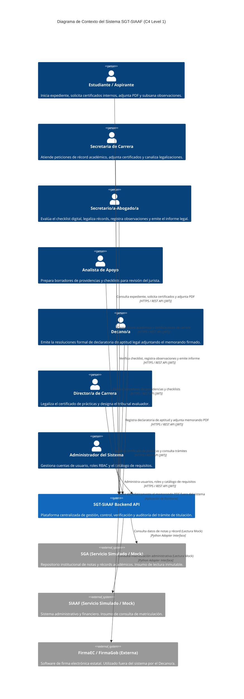
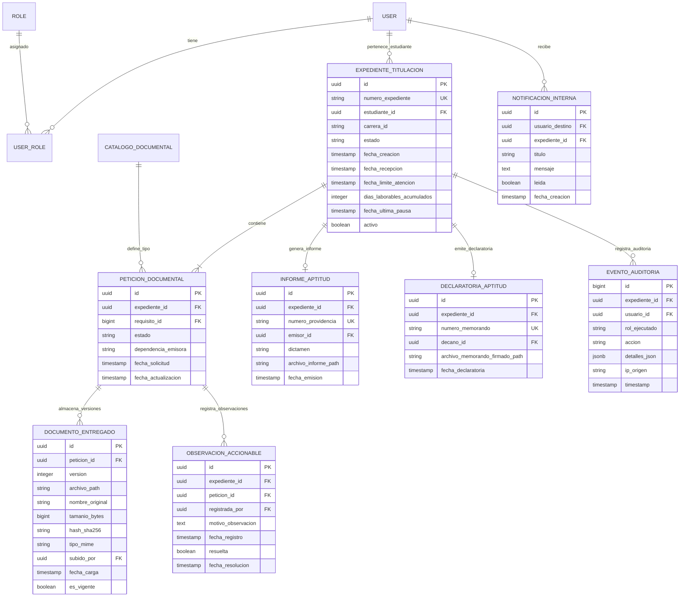

# PLANIFICACIÓN TÉCNICA Y ARQUITECTÓNICA DEL PROYECTO SGT-SIAAF (plan.md)

**Sistema de Gestión del Trámite de Titulación integrado al SIAAF**  
*Universidad Nacional de Loja — Facultad de la Energía, las Industrias y los Recursos Naturales No Renovables (FEIRNNR)*  
**Carrera de Computación — Asignatura: Desarrollo Basado en Plataformas (5.º Ciclo)**  
**Versión del Artefacto:** 1.0.0 (Oficial)  
**Estatus Documental:** Plan Técnico y Arquitectónico — Marco de Trabajo GitHub Spec Kit (Etapa `plan`)  
**Fecha de Emisión:** 20 de octubre de 2026  
**Artefactos Relacionados:** `constitucion.md` (v2.0.0), `specify_refactorizado.md` (v2.0.0), `clarify.md` (v1.0.0)  

---

## 1. IDENTIFICACIÓN Y METADATOS DEL PLAN

* **Nombre del Proyecto:** SGT-SIAAF — Sistema de Gestión del Trámite de Titulación integrado al SIAAF.
* **Nombre del Artefacto:** `plan.md` (Dossier Maestro de Arquitectura, Diseño de Dominio e Implementación Técnica).
* **Versión:** 1.0.0 (Aprobado para la fase de construcción backend).
* **Estatus:** Inmutable y vinculante para la etapa de tareas (`tasks.md`) y desarrollo.
* **Fecha de Registro:** 20 de octubre de 2026.
* **Autores y Responsables:** Equipo de Arquitectura e Ingeniería de Software SGT-SIAAF (Carrera de Computación, UNL).
* **Jerarquía de Autoridad:**
  1. `constitucion.md` (v2.0.0): Norma suprema de gobernanza, simulación y seguridad.
  2. `specify_refactorizado.md` (v2.0.0): Especificación funcional, requisitos, HUs y criterios BDD.
  3. `clarify.md` (v1.0.0): Registro maestro de clarificaciones, decisiones cerradas (DEC-01 a DEC-05) y gestión de ambigüedades.
  4. `plan.md` (v1.0.0 - Este documento): Diseño de arquitectura hexagonal, monolito modular, modelo de dominio, contratos REST, persistencia y estrategia de pruebas.

---

## 2. RESUMEN EJECUTIVO

El **Plan Técnico y Arquitectónico (`plan.md`)** establece la estructura de software, patrones de diseño, componentes técnicos, esquemas de persistencia, contratos de API e infraestructura del **SGT-SIAAF**. El objetivo del sistema es digitalizar, centralizar, controlar y auditar la fase administrativa del proceso de titulación de grado en la Carrera de Computación de la FEIRNNR - UNL.

Para cumplir con las restricciones del sílabo de la asignatura *Desarrollo Basado en Plataformas* (Unidad 1: 5 semanas de desarrollo backend) y los 20 principios de la `constitucion.md`, la arquitectura seleccionada combina un **Monolito Modular** con **Arquitectura Hexagonal (Ports & Adapters)**, construido sobre **Python 3.12+**, **Django 5.x** y **Django REST Framework (DRF)**, respaldado por **PostgreSQL 16** y contenerizado con **Docker Compose**.

### Principales Puntos Clave del Diseño Arquitectónico:
1. **Delimitación en la Fase 1 (MVP — Aptitud Legal):** Foco prioritario en el subproceso de Declaratoria de Aptitud Legal (Art. 235 RRA-UNL), que comprende la recepción de solicitudes, petición interna de certificados sin correo, verificación con checklist digital de 5 requisitos base, registro de observaciones accionables con pausa automática del plazo de 8 días hábiles, emisión del informe legal y registro de la declaratoria por el Decano/a.
2. **Desacoplamiento Hexagonal Estricto:** Separación clara entre el *Núcleo del Dominio* (entidades y reglas de negocio puras), *Casos de Uso / Servicios de Aplicación* (coordinación transaccional), *Puertos* (interfaces abstractas) y *Adaptadores* (vistas DRF, ORM Django, almacenamiento de archivos, mocks de integración).
3. **Control de Acceso Basado en Roles (RBAC):** Autenticación *stateless* mediante tokens JWT y autorización *server-side* para 8 roles institucionales confirmados (`ESTUDIANTE`, `SECRETARIA_CARRERA`, `SECRETARIO_ABOGADO`, `ANALISTA_APOYO`, `DECANO`, `DIRECTOR_CARRERA`, `RESPONSABLE_DEPENDENCIA` y `ADMINISTRADOR`).
4. **Interoperabilidad Desacoplada sin Escritura Legada:** Los sistemas externos (SGA y SIAAF) no son reemplazados ni modificados. Toda información académica (como el récord de notas) se ingresa vía carga de archivos o mediante adaptadores de simulación (*Mocks*). El promedio del récord provisto por el SGA es inalterable.
5. **Notificaciones 100% Internas (*In-App*):** En acatamiento estricto a la decisión DEC-01, las notificaciones del MVP son exclusivamente internas al sistema, eliminando la necesidad de infraestructura asíncrona SMTP/Celery/Redis en la Unidad 1.
6. **Manejo Seguro de Documentos y Firmas:** Validación estricta en servidor para archivos PDF (máximo 10 MB, verificación de tipo MIME y *magic bytes* `%PDF-`). Los borradores de informes y providencias (#590 y #162) se autogeneran en PDF desde plantillas; las firmas de memorando se realizan externamente (FirmaEC) y las actas de sustentación (Fase 2) conservan la firma autógrafa física obligatoria.

---

## 3. OBJETIVO Y ALCANCE TÉCNICO

### 3.1 Objetivo Técnico General
Diseñar y construir una arquitectura backend robusta, segura, modular, mantenible y 100% reproducible en contenedores Docker, que implemente las reglas de negocio y los contratos RESTful del SGT-SIAAF para la Fase 1 (MVP — Aptitud Legal), garantizando trazabilidad completa desde los requisitos (`specify_refactorizado.md`) hasta las suites de pruebas automatizadas (`pytest`).

### 3.2 Alcance Técnico por Fases Tecnológicas
* **Fase Tecnológica 1 — Backend API (Alcance Actual de la Unidad 1):**
  - Implementación del núcleo de dominio, servicios de aplicación y adaptadores de infraestructura para la Fase 1 (Aptitud Legal).
  - Implementación de la matriz RBAC para los 8 roles en endpoints RESTful bajo la ruta `/api/v1/`.
  - Persistencia relacional en PostgreSQL con transacciones atómicas (`@transaction.atomic`) y bloqueo pesimista (`select_for_update()`).
  - Documentación del contrato API en esquema OpenAPI v3 (Swagger / Redoc).
  - Suite de pruebas automatizadas con `pytest` que alcance >70% de cobertura en la lógica de negocio.
  - Entorno contenerizado ejecutable mediante `docker-compose up --build`.
* **Fase Tecnológica 2 — Frontend Web (Unidad 2 - Incremento):** Consumo del contrato API por el cliente web SPA/MPA.
* **Fase Tecnológica 3 — Cliente Móvil (Unidad 3 - Incremento):** Consumo del contrato API por la aplicación móvil.

---

## 4. FUENTES, EVIDENCIAS Y RESTRICCIONES

### 4.1 Fuentes Primarias de Trazabilidad
| ID Fuente | Documento / Recurso | Utilidad Arquitectónica Directa |
| :--- | :--- | :--- |
| **F-01** | `constitucion.md` (v2.0.0) | Principios obligatorios C-001 a C-020 (simulación, RBAC, auditoría, JWT, Docker, OpenAPI). |
| **F-02** | `specify_refactorizado.md` (v2.0.0) | Requisitos funcionales (RF-001 a RF-016), no funcionales (RNF-001 a RNF-018) e historias BDD. |
| **F-03** | `clarify.md` (v1.0.0) | Decisiones cerradas DEC-01 a DEC-05 (notificaciones in-app, Opción A de carga, pausa de plazos). |
| **F-04** | `RRA-UNL` (27-01-2021) | Reglas normativas de los Arts. 235 (Aptitud Legal), 236-237 (Sustentación) y 243-244 (SENESCYT). |
| **F-05** | Plantillas `#590` y `#162` | Modelos oficiales de providencias, informes, checklist de 5 requisitos y memorando de declaratoria. |
| **F-06** | `transcripcion-final.md` | Directrices docentes (firma autógrafa en actas, no reescritura en SGA, promedio inalterable). |
| **F-07** | Documentos de Análisis 01-05 (v3) | Mapeo de procesos manuales, matrices de riesgo ISO 31000 y ADR técnico de Django+DRF. |
| **F-08** | `Sílabo DBP` (PAO 2026-2027) | Restricción de 5 semanas para el backend en la Unidad 1 y estándar OpenAPI v3. |

### 4.2 Restricciones Técnicas Absolutas
1. **R-TEC-01 (Air-Gapped Sandbox / No External Network):** Durante la ejecución de pruebas y demostraciones en el sandbox local, el backend no dependerá de servicios externos en la nube ni APIs no contenidas en la red de Docker.
2. **R-TEC-02 (No Direct DB Mutation on Legacy Systems):** Queda prohibida cualquier operación de escritura en bases de datos del SGA o SIAAF.
3. **R-TEC-03 (PDF Size & Validation Limit):** Los archivos de prueba deben ser PDF de máximo **10 MB**, validados por *magic bytes* `%PDF-`.
4. **R-TEC-04 (Stateless Authentication):** Uso obligatorio de tokens JWT transmitidos en la cabecera `Authorization: Bearer <token>`.
5. **R-TEC-05 (In-App Notifications Only):** No se utilizará infraestructura SMTP ni brokers asíncronos para el MVP.

---

## 5. REQUISITOS Y DECISIONES QUE CONDICIONAN LA ARQUITECTURA

| Requisito / Decisión | Condición Generada sobre la Arquitectura Backend | Componente Afectado |
| :--- | :--- | :--- |
| **RF-003, RN-002, AP-01** | El cálculo de los 8 días laborables debe pausarse en estado `OBSERVADA` y reanudarse al subsanar. | `ExpedienteService`, `PlazoLaboralCalculator` |
| **RF-005, RNF-004, C-006** | Inspección de bytes en memoria de archivos PDF antes de persistir en almacenamiento privado. | `PDFValidationAdapter`, `MediaStorageService` |
| **RF-006, RF-009, AP-06** | Verificación de checklist y emisión de informe requiere bloques atómicos con bloqueo pesimista en DB. | `ChecklistService`, `select_for_update()` |
| **RNF-001, RNF-002, C-004** | Middleware de autorización RBAC server-side en cada vista API antes de ejecutar casos de uso. | `RBACPermissionEvaluator`, `JWTAuthentication` |
| **DEC-01, RF-012** | Eventos de dominio desacoplados generan registros sincrónicos en la entidad `NotificacionInterna`. | `NotificationService`, Django Signals |
| **DEC-02, AP-03** | Permisos de carga de certificados habilitados para roles `ESTUDIANTE` y `SECRETARIA_CARRERA` con atributo `subido_por`. | `PeticionDocumentalService`, `DocumentoEntregado` |
| **DEC-04, RN-006** | Generación de borradores PDF desde plantillas en backend y preservación de firma autógrafa física en actas. | `PDFGeneratorAdapter` (ReportLab / WeasyPrint) |

---

## 6. INVESTIGACIÓN Y CRITERIOS DE SELECCIÓN

### 6.1 Evaluación Comparativa de Patrones de Arquitectura

| Criterio | Monolito Modular + Hexagonal | Monolito Tradicional por Capas | Microservicios |
| :--- | :--- | :--- | :--- |
| **Mantenibilidad** | **Excelente:** Desacoplamiento total entre dominio e infraestructura. | **Media:** Riesgo de fuga de reglas a vistas y modelos ORM. | **Alta:** Complejidad alta de red y consistencia eventualmente distribuida. |
| **Tiempo de Entrega (5 sem)** | **Alto/Óptimo:** Cohesión por módulos sin sobrecarga de microservicios. | **Muy Alto:** Rápido al inicio, riesgoso en refactorización. | **Muy Bajo:** Imposible de completar y probar en 5 semanas. |
| **Integración Futura SGA** | **Excelente:** Adaptadores aislados reemplazables sin tocar el dominio. | **Media:** Acoplamiento directo del ORM con la API externa. | **Alta:** Manejo complejo de transacciones distribuidas (Saga). |
| **Pruebas Automatizadas** | **Excelente:** Pruebas unitarias de dominio sin levantar servidor o DB. | **Media:** Dependencia obligatoria de la base de datos Django. | **Compleja:** Pruebas de integración entre múltiples servicios. |
| **Conclusión** | **SELECCIONADO (ADR-001)** | Descartado por acoplamiento. | Descartado por sobreingeniería. |

### 6.2 Selección del Framework y Base de Datos
* **Backend Framework:** **Django 5.x + Django REST Framework (DRF)** (ADR-002).
  - *Justificación:* Paradigma *batteries-included*, ORM declarativo, serializadores acoplados a validaciones, panel de administración auditable y ecosistema maduro de seguridad.
* **Base de Datos:** **PostgreSQL 16** (ADR-002).
  - *Justificación:* Soporte nativo de transacciones ACID, tipos JSONB para bitácora de auditoría, funciones de fecha y bloqueo pesimista mediante `SELECT FOR UPDATE`.
* **Autenticación:** **SimpleJWT (`djangorestframework-simplejwt`)** (ADR-003).
  - *Justificación:* Estándar IETF RFC 7519, tokens *stateless* firmados con clave secreta HS256, sin consultar base de datos en cada petición.

---

## 7. ARQUITECTURA SELECCIONADA Y JUSTIFICACIÓN

La arquitectura del **SGT-SIAAF** se define como un **Monolito Modular con Arquitectura Hexagonal (Ports & Adapters)**.

```
+-----------------------------------------------------------------------------------+
|                                  CAPA DE INFRAESTRUCTURA                          |
|                                                                                   |
|   +-----------------------+     +-----------------------+     +-------------------+   |
|   |  Cliente Web (SPA)    |     | Application Móvil     |     | Swagger / OpenAPI |   |
|   +-----------+-----------+     +-----------+-----------+     +---------+---------+   |
|               |                             |                           |         |
|               +-----------------------------+---------------------------+         |
|                                             |                                     |
|                                             v                                     |
|                      +--------------------------------------+                     |
|                      | REST API Adapters (DRF ViewSets)     |                     |
|                      +------------------+-------------------+                     |
|                                         |                                         |
|                                         v                                         |
|  +-----------------------------------------------------------------------------+  |
|  |                           PUERTOS DE ENTRADA (Input Ports)                  |  |
|  |                                                                             |  |
|  |   +---------------------------------------------------------------------+   |  |
|  |   |                   CAPA DE APLICACIÓN (Use Cases / Services)          |   |  |
|  |   |                                                                     |   |  |
|  |   |   +-------------------------------------------------------------+   |   |  |
|  |   |   |                   CAPA DE DOMINIO (Entities & Rules)        |   |   |  |
|  |   |   |                                                             |   |   |  |
|  |   |   |   * ExpedienteTitulacion   * PeticionDocumental               |   |   |  |
|  |   |   |   * RequisitoDocumental    * PlazoLaboralCalculator           |   |   |  |
|  |   |   |   * ObservacionAccionable  * PermisoEvaluator (RBAC)            |   |   |  |
|  |   |   |                                                             |   |   |  |
|  |   |   +-------------------------------------------------------------+   |   |  |
|  |   |                                                                     |   |  |
|  |   |   * CrearExpedienteUseCase       * VerificartChecklistUseCase       |   |  |
|  |   |   * RegistrarObservacionUseCase  * SubsanarRequisitoUseCase         |   |  |
|  |   |   * EmitirInformeUseCase         * DeclararAptitudUseCase           |   |  |
|  |   |                                                                     |   |  |
|  |   +---------------------------------------------------------------------+   |  |
|  |                                                                             |  |
|  |                           PUERTOS DE SALIDA (Output Ports)                  |  |
|  +--------------------------------------+--------------------------------------+  |
|                                         |                                         |
|                                         v                                         |
|   +-------------------+       +-------------------+       +-------------------+   |
|   | Persistence Port  |       |  Document Storage |       | SGA Mock Adapter  |   |
|   | (Django ORM / DB) |       |  (Private Media)  |       | (Legacy Service)  |   |
|   +---------+---------+       +---------+---------+       +---------+---------+   |
|             |                           |                           |             |
|             v                           v                           v             |
|    +-----------------+         +-----------------+         +-----------------+    |
|    |  PostgreSQL 16  |         | File System / S3|         | JSON Mock Data  |    |
|    +-----------------+         +-----------------+         +-----------------+    |
|                                                                                   |
+-----------------------------------------------------------------------------------+
```

### Reglas Inviolables de la Dirección de Dependencias:
1. **El Dominio es Agnóstico:** La capa de *Dominio* no importa ningún paquete de Django, DRF o PostgreSQL. Contiene clases de Python puras (`dataclasses`) y excepciones del dominio.
2. **Inversión de Dependencias:** La capa de *Aplicación* interactúa con la infraestructura únicamente a través de interfaces abstractas (*Puertos*).
3. **Los Adaptadores son Periféricos:** Los detalles de entrega (HTTP, DRF, ORM, FileSystem) residen en los adaptadores externos y dependen del dominio, nunca al revés.

---

## 8. DIAGRAMA DE CONTEXTO

El siguiente diagrama Mermaid representa el límite del sistema **SGT-SIAAF** y sus interacciones con los usuarios institucionales y los adaptadores de integración simulada:



---

## 9. DIAGRAMA DE CONTENEDORES O COMPONENTES PRINCIPALES

El siguiente diagrama Mermaid ilustra la arquitectura de contenedores Docker Compose del entorno **SGT-SIAAF**:

```mermaid
C4Container
    title Diagrama de Contenedores del Sistema SGT-SIAAF (C4 Level 2)

    Container(web_client, "Cliente Web SPA", "HTML5 / JS / Framework", "Interfaz de usuario para navegación, carga de archivos y consulta de bandejas.")
    Container(mobile_app, "Cliente Móvil", "Flutter / React Native", "Aplicación móvil para seguimiento de estados y recepción de notificaciones in-app.")

    ContainerBoundary(backend_boundary, "Contenedor Backend SGT-SIAAF (Docker)") {
        Component(nginx, "Nginx Reverse Proxy", "Nginx 1.24", "Terminación TLS, servidor de archivos estáticos y proxy inverso hacia Gunicorn.")
        Component(gunicorn, "WSGI/ASGI Server", "Gunicorn / Uvicorn", "Servidor de aplicaciones Python de producción.")
        Component(django_app, "Django REST Framework App", "Python 3.12 / Django 5.x", "Monolito modular con arquitectura hexagonal, controladores REST, RBAC y motor de estados.")
        Component(pdf_engine, "PDF Generator Engine", "ReportLab / WeasyPrint", "Motor de renderizado de borradores de providencias y memorandos en PDF.")
    }

    ContainerDb(postgres_db, "PostgreSQL Database", "PostgreSQL 16", "Almacena la persistencia relacional, expedientes, checklist, auditoría JSONB y notificaciones.")
    Container(file_storage, "Private File Storage", "Volume Mount / Docker Local Storage", "Almacenamiento privado para archivos PDF de certificados y resoluciones.")

    Rel(web_client, nginx, "Peticiones HTTPS / REST API", "JSON / Multipart")
    Rel(mobile_app, nginx, "Peticiones HTTPS / REST API", "JSON")
    Rel(nginx, gunicorn, "Proxy Pass", "HTTP / Unix Socket")
    Rel(gunicorn, django_app, "Ejecuta código WSGI", "Python WSGI")
    Rel(django_app, pdf_engine, "Genera borradores PDF", "In-Process Call")
    Rel(django_app, postgres_db, "Lectura / Escritura Relacional con Transacciones", "psycopg3 / SQL")
    Rel(django_app, file_storage, "Almacena y lee archivos PDF validados", "POSIX File I/O")
```

---

## 10. ARQUITECTURA HEXAGONAL Y DIRECCIÓN DE DEPENDENCIAS

```mermaid
graph TD
    subgraph Adaptadores_Entrada [Adaptadores Primarios / Entrada]
        DRF_Views[REST API Controllers / DRF ViewSets]
        Admin_Views[Django Custom Admin Views]
    end

    subgraph Puertos_Entrada [Puertos de Entrada / Application Interfaces]
        Expediente_UC[IExpedienteUseCase]
        Checklist_UC[IChecklistUseCase]
        Resolution_UC[IResolutionUseCase]
    end

    subgraph Dominio_Core [Núcleo de Dominio / Domain Core]
        Expediente_Entity[Entity: ExpedienteTitulacion]
        Peticion_Entity[Entity: PeticionDocumental]
        Plazo_Calculator[Domain Service: PlazoLaboralCalculator]
        RBAC_Evaluator[Domain Service: RBACEvaluator]
    end

    subgraph Puertos_Salida [Puertos de Salida / Infrastructure Interfaces]
        IExpedienteRepo[IExpedienteRepository]
        IPDFStorage[IPDFStoragePort]
        ISGAMock[ISGAIntegrationPort]
    end

    subgraph Adaptadores_Salida [Adaptadores Secundarios / Salida]
        Django_ORM_Repo[Django ORM Repository Adapter]
        Private_FS_Adapter[Local Private FileStorage Adapter]
        SGA_Mock_Adapter[SGA JSON Mock Adapter]
        Postgres_DB[(PostgreSQL 16 DB)]
    end

    DRF_Views -->|Invoca| Expediente_UC
    DRF_Views -->|Invoca| Checklist_UC
    DRF_Views -->|Invoca| Resolution_UC

    Expediente_UC -->|Usa| Expediente_Entity
    Expediente_UC -->|Usa| Plazo_Calculator
    Expediente_UC -->|Usa| RBAC_Evaluator
    Expediente_UC -->|Depende de| IExpedienteRepo
    Expediente_UC -->|Depende de| IPDFStorage
    Expediente_UC -->|Depende de| ISGAMock

    Django_ORM_Repo ..|>|Implementa| IExpedienteRepo
    Private_FS_Adapter ..|>|Implementa| IPDFStorage
    SGA_Mock_Adapter ..|>|Implementa| ISGAMock

    Django_ORM_Repo -->|Persiste en| Postgres_DB
```

---

## 11. DISEÑO DEL MONOLITO MODULAR

El backend se organiza en **6 módulos funcionales altamente cohesionados** con responsabilidades delimitadas, previniendo dependencias circulares:

```
/workspace/backend/src/apps/
├── authentication/         # Módulo 1: Gestión de Usuarios, JWT y Matriz RBAC
├── expedientes/            # Módulo 2: Expediente Global, Motor de Estados y Cómputo de Plazos
├── peticiones/             # Módulo 3: Peticiones Documentales e Ingestión PDF
├── verificacion/           # Módulo 4: Checklist Digital, Observaciones y Bloqueo de Informes
├── resoluciones/           # Módulo 5: Borradores PDF, Informes Legal #590 y Declaratoria Decano #162
└── notificaciones/         # Módulo 6: Notificaciones Internas e Historial de Auditoría
```

### Tabla de Propiedad de Entidades y Comunicación entre Módulos:

| Módulo Funcional | Entidades Propietarias | Servicios Expuestos a otros Módulos | Módulos de los que Depende |
| :--- | :--- | :--- | :--- |
| `authentication` | `User`, `Role`, `UserRole` | `verify_user_permissions(user, action, resource)` | Ninguno (Núcleo) |
| `expedientes` | `ExpedienteTitulacion`, `HistorialEstado` | `get_expediente_status()`, `update_expediente_state()` | `authentication` |
| `peticiones` | `CatalogoDocumental`, `PeticionDocumental`, `DocumentoEntregado` | `verify_peticiones_complete(expediente_id)` | `expedientes`, `authentication` |
| `verificacion` | `ChecklistVerification`, `ObservacionAccionable` | `is_checklist_fully_verified(expediente_id)` | `peticiones`, `expedientes` |
| `resoluciones` | `InformeAptitud`, `DeclaratoriaAptitud` | `generate_informe_draft()`, `register_declaratoria()` | `verificacion`, `expedientes` |
| `notificaciones` | `NotificacionInterna`, `EventoAuditoria` | `dispatch_notification()`, `log_audit_event()` | Todos (vía Django Signals) |

---

## 12. MODELO DE DOMINIO Y RESPONSABILIDADES

El siguiente diagrama ER Mermaid detalla las entidades del dominio relacional en **PostgreSQL**:



---

## 13. ESTRUCTURA DE DIRECTORIOS PROPUESTA

```
/workspace/backend/
├── Dockerfile
├── docker-compose.yml
├── manage.py
├── pyproject.toml
├── requirements.txt
├── .env.example
├── docs/
│   └── adr/
│       ├── 0001-arquitectura-hexagonal-monolito-modular.md
│       ├── 0002-stack-django-drf-postgresql.md
│       ├── 0003-autenticacion-jwt-stateless.md
│       ├── 0004-estrategia-mock-sga-siaaf.md
│       ├── 0005-validacion-almacenamiento-pdf.md
│       ├── 0006-notificaciones-internas-mvp.md
│       ├── 0007-concurrencia-bloqueo-pesimista-checklist.md
│       └── 0008-estrategia-pruebas-pytest.md
└── src/
    ├── config/                 # Configuración Global de Django
    │   ├── settings/
    │   │   ├── base.py
    │   │   ├── local.py
    │   │   └── test.py
    │   ├── urls.py
    │   ├── wsgi.py
    │   └── asgi.py
    ├── core/                   # Núcleo Transversal y Abstracciones Base
    │   ├── domain/
    │   │   ├── exceptions.py
    │   │   └── value_objects.py
    │   ├── ports/
    │   │   ├── storage_port.py
    │   │   └── legacy_sga_port.py
    │   └── adapters/
    │       ├── local_storage.py
    │       └── mock_sga.py
    └── apps/                   # Módulos del Monolito Modular
        ├── authentication/
        │   ├── domain/
        │   ├── services/
        │   ├── ports/
        │   └── adapters/ (views, serializers, models)
        ├── expedientes/
        │   ├── domain/
        │   ├── services/
        │   └── adapters/
        ├── peticiones/
        │   ├── domain/
        │   ├── services/
        │   └── adapters/
        ├── verificacion/
        │   ├── domain/
        │   ├── services/
        │   └── adapters/
        ├── resoluciones/
        │   ├── domain/
        │   ├── services/
        │   └── adapters/
        └── notificaciones/
            ├── domain/
            ├── services/
            └── adapters/
```

---

## 14. PERSISTENCIA, TRANSACCIONES E INTEGRIDAD

### 14.1 Manejo de Transacciones Atómicas
Toda operación que afecte múltiples tablas o requiera transiciones de estado inmutables debe ejecutarse dentro de un bloque decorado con `@transaction.atomic`.

### 14.2 Control de Concurrencia en Checklist y Evaluaciones (ADR-007)
Para evitar condiciones de carrera (*race conditions*) cuando el `Secretario/a-Abogado/a` y el `Analista de Apoyo` accedan simultáneamente al checklist de un expediente:
```python
# Ejemplo de Bloqueo Pesimista en Caso de Uso de Verificación
from django.db import transaction
from apps.expedientes.adapters.models import ExpedienteORM

@transaction.atomic
def verificar_checklist_and_emitir_informe(expediente_id: str, user_id: str):
    # Bloqueo de fila mediante SELECT FOR UPDATE
    expediente = ExpedienteORM.objects.select_for_update().get(id=expediente_id)
    
    # Validar que todas las peticiones estén VERIFICADO
    peticiones_pendientes = expediente.peticiones.exclude(estado='VERIFICADO').exists()
    if peticiones_pendientes:
        raise DomainValidationError("No se puede emitir el informe: existen requisitos no verificados o con observaciones.")
    
    # Actualizar estado e insertar informe de forma atómica
    expediente.estado = 'INFORME_EMITIDO'
    expediente.save()
```

---

## 15. CONTRATOS REST Y ESTRATEGIA OPENAPI

Toda la API backend se expone bajo el prefijo `/api/v1/`. A continuación se resume la tabla maestra de endpoints RESTful:

| Endpoint | Método | Rol Autorizado (RBAC) | Descripción | Código HTTP Exitoso | Códigos Error |
| :--- | :--- | :--- | :--- | :--- | :--- |
| `/api/v1/auth/token/` | `POST` | Público | Autenticación y obtención de par de tokens JWT. | `200 OK` | `401 Unauthorized` |
| `/api/v1/expedientes/` | `POST` | `ESTUDIANTE` | Registra expediente en `BORRADOR` con 5 requisitos base. | `201 Created` | `400`, `403` |
| `/api/v1/expedientes/bandeja/` | `GET` | Todos los Roles | Consulta bandeja filtrada por área y rol asignado. | `200 OK` | `401`, `403` |
| `/api/v1/expedientes/{id}/` | `GET` | Propietario / Autoridad | Detalle del expediente y estado de sus peticiones. | `200 OK` | `403`, `404` |
| `/api/v1/expedientes/{id}/enviar/` | `POST` | `ESTUDIANTE` | Pasa a `ENVIADA`, marca timestamp y calcula plazo 8 días. | `200 OK` | `400`, `422` |
| `/api/v1/peticiones/` | `POST` | `ESTUDIANTE` | Petición interna de certificado sin correo. | `201 Created` | `400`, `403` |
| `/api/v1/peticiones/{id}/documento/` | `POST` | `ESTUDIANTE` / `SECRETARIA` | Carga de archivo PDF validando magic bytes y hash. | `201 Created` | `400`, `403` |
| `/api/v1/checklist/{id}/` | `PUT` | `SECRETARIO_ABOGADO` | Evalúa requisito (`VERIFICADO` / `OBSERVADO`). | `200 OK` | `400`, `403` |
| `/api/v1/expedientes/{id}/observar/` | `POST` | `SECRETARIO_ABOGADO` | Registra observación, pasa a `OBSERVADA` y pausa plazo. | `200 OK` | `422` |
| `/api/v1/informes/` | `POST` | `SECRETARIO_ABOGADO` | Emite informe legal (#590) e inmutabiliza. | `201 Created` | `422` |
| `/api/v1/declaratorias/` | `POST` | `DECANO` | Registra declaratoria (#162) y adjunta memorando. | `201 Created` | `403`, `422` |
| `/api/v1/notificaciones/` | `GET` | Todos los Roles | Consulta avisos internos del usuario. | `200 OK` | `401` |

---

## 16. CONTRATOS INTERNOS ENTRE MÓDULOS

Para evitar acoplamiento directo entre aplicaciones Django, los módulos se comunican utilizando **interfaces de servicios de aplicación** o **Django Signals**:

```python
# Ejemplo de Contrato Interno vía Interface Service
class INotificationService(ABC):
    @abstractmethod
    def send_in_app_notification(self, user_id: str, title: str, message: str, expediente_id: str) -> None:
        pass

# Despacho desacoplado al cambiar estado a OBSERVADA
def on_expediente_observado(expediente_id: str, estudiante_id: str, motivo: str):
    notification_service.send_in_app_notification(
        user_id=estudiante_id,
        title="Requisito Observado",
        message=f"Su trámite presenta observaciones: {motivo}",
        expediente_id=expediente_id
    )
```

---

## 17. ESTRATEGIA DE INTEROPERABILIDAD FUTURA CON EL SGA

En cumplimiento estricto con los Principios C-002 y C-017 de la Constitución y la decisión DEC-05, el SGT-SIAAF no ejecuta conexiones directas ni modificaciones en las bases de datos del SGA o SIAAF.

```mermaid
graph LR
    subgraph SGT_SIAAF_Domain [SGT-SIAAF Core Domain]
        ExpedienteService[Expediente Service]
    end

    subgraph Port_Layer [Output Ports]
        ISGALegacyPort[ISGALegacyPort Abstract Interface]
    end

    subgraph Adapters_Layer [Adapters Implementation]
        SGA_Mock_Adapter[SGA JSON Mock Adapter (Current MVP)]
        SGA_REST_Adapter[SGA Future REST Adapter (Future Phase)]
    end

    subgraph External_Legacy [External Systems]
        SGA_Real_DB[(SGA Production DB - Read Only)]
    end

    ExpedienteService --> ISGALegacyPort
    SGA_Mock_Adapter ..|> ISGALegacyPort
    SGA_REST_Adapter ..|> ISGALegacyPort
    SGA_REST_Adapter -->|Future TLS/OAuth2| SGA_Real_DB
```

---

## 18. SEGURIDAD, PRIVACIDAD Y AUDITORÍA

1. **Autenticación JWT Stateless (ADR-003):** Tokens de acceso con vida útil de 60 minutos y tokens de refresco de 24 horas.
2. **Matriz RBAC y Aislamiento por Ámbito (IDOR):** Todas las consultas en los repositorios ORM aplican filtros por usuario autenticado o carrera/facultad:
   ```python
   # Prevención de IDOR en Repositorio Django ORM
   def get_queryset(self):
       user = self.request.user
       if user.role == 'ESTUDIANTE':
           return ExpedienteORM.objects.filter(estudiante_id=user.id)
       elif user.role in ['SECRETARIA_CARRERA', 'DIRECTOR_CARRERA']:
           return ExpedienteORM.objects.filter(carrera_id=user.carrera_id)
       return ExpedienteORM.objects.filter(facultad_id=user.facultad_id)
   ```
3. **Bitácora Inmutable de Auditoría (Principio C-008):** Inserción en la tabla `EventoAuditoria` en formato JSONB conteniendo usuario, rol, timestamp UTC, IP y resumen de la acción.

---

## 19. GESTIÓN DOCUMENTAL

1. **Estrategia de Almacenamiento Privado (ADR-005):** Los archivos PDF se guardan en el volumen local `/workspace/backend/media/private/expedientes/{year}/{expediente_id}/`. Se prohíbe el acceso web directo sin pasar por el middleware de autenticación de Django.
2. **Validación de Encabezado (*Magic Bytes*):**
   ```python
   def validate_pdf_bytes(file_obj):
       header = file_obj.read(5)
       file_obj.seek(0)
       if header != b'%PDF-':
           raise ValidationError("El archivo cargado no es un documento PDF válido.")
   ```

---

## 20. NOTIFICACIONES INTERNAS

Conforme a la decisión **DEC-01 (clarify.md)**, las notificaciones del MVP son **exclusivamente internas al sistema (*in-app*)**.

* **Eventos Desencadenantes:**
  1. Solicitud enviada (`ENVIADA`) -> Notificación a la Secretaria Abogada.
  2. Requisito observado (`OBSERVADA`) -> Notificación al Estudiante.
  3. Requisito subsanado (`EN_VERIFICACION`) -> Notificación a la Secretaria Abogada.
  4. Informe emitido (`INFORME_EMITIDO`) -> Notificación al Decano/a.
  5. Declaratoria registrada (`DECLARADA_APTA`) -> Notificación con copia a Secretaria Abogada, Director y Estudiante.

---

## 21. ADR PROPUESTOS Y DECISIONES PENDIENTES DE APROBACIÓN

```
/workspace/backend/docs/adr/
├── 0001-arquitectura-hexagonal-monolito-modular.md (Aceptado)
├── 0002-stack-django-drf-postgresql.md (Aceptado)
├── 0003-autenticacion-jwt-stateless.md (Aceptado)
├── 0004-estrategia-mock-sga-siaaf.md (Aceptado)
├── 0005-validacion-almacenamiento-pdf.md (Aceptado)
├── 0006-notificaciones-internas-mvp.md (Aceptado)
├── 0007-concurrencia-bloqueo-pesimista-checklist.md (Aceptado)
└── 0008-estrategia-pruebas-pytest.md (Aceptado)
```

---

## 22. ESTRATEGIA DE PRUEBAS Y CALIDAD

La estrategia de calidad se basa en pruebas automatizadas ejecutadas mediante `pytest` / `pytest-django`:

1. **Pruebas Unitarias de Dominio:** Verificación de entidades, calculador de plazos de 8 días hábiles y evaluador RBAC sin levantar base de datos.
2. **Pruebas de Integración y Permisos RBAC:** Ejecución de peticiones HTTP con clientes API autenticados probando respuestas `200 OK`, `201 Created`, `401 Unauthorized` y `403 Forbidden` para cada uno de los 8 roles.
3. **Pruebas de Motor de Estados y Pausa:** Simulación del ciclo completo (`BORRADOR` -> `ENVIADA` -> `OBSERVADA` -> `EN_VERIFICACION` -> `INFORME_EMITIDO` -> `DECLARADA_APTA`) comprobando la acumulación de pausas de tiempo.
4. **Criterio de Cobertura:** Cobertura mínima obligatoria del **70%** en la lógica de negocio comprobada con `pytest-cov`.

---

## 23. INFRAESTRUCTURA Y ENTORNO DE DESARROLLO

### 23.1 Configuración de Docker Compose (`docker-compose.yml`)
```yaml
version: '3.8'

services:
  db:
    image: postgres:16-alpine
    container_name: sgt_postgres_db
    environment:
      POSTGRES_DB: sgt_siaaf_db
      POSTGRES_USER: sgt_user
      POSTGRES_PASSWORD: sgt_password_secure
    volumes:
      - postgres_data:/var/lib/postgresql/data
    ports:
      - "5432:5432"

  backend:
    build: .
    container_name: sgt_django_backend
    command: python manage.py runserver 0.0.0.0:8000
    volumes:
      - .:/workspace/backend
      - private_media:/workspace/backend/media/private
    ports:
      - "8000:8000"
    environment:
      - DEBUG=1
      - SECRET_KEY=django-insecure-secret-key-development
      - DATABASE_URL=postgres://sgt_user:sgt_password_secure@db:5432/sgt_siaaf_db
    depends_on:
      - db

volumes:
  postgres_data:
  private_media:
```

---

## 24. MATRIZ DE TRAZABILIDAD ARQUITECTÓNICA

| ID Requisito | Requisito Funcional / No Funcional | Módulo Responsable | Caso de Uso / Puerto | Componente / Adaptador | Prueba Relacionada | ADR |
| :--- | :--- | :--- | :--- | :--- | :--- | :--- |
| `RF-001` | Registro de Solicitud | `expedientes` | `CrearExpedienteUC` | `ExpedienteViewSet` | `test_crear_expediente` | ADR-001 |
| `RF-002` | Timestamp y Providencia | `expedientes` | `EnviarExpedienteUC` | `ExpedienteORM` | `test_enviar_timestamp` | ADR-002 |
| `RF-003` | Plazo 8 Días Laborables | `expedientes` | `PlazoLaboralCalculator` | `DomainService` | `test_calculo_dias_habiles` | ADR-001 |
| `RF-005` | Carga de Archivos PDF | `peticiones` | `CargarDocumentoUC` | `PDFValidationAdapter` | `test_carga_pdf_magic_bytes` | ADR-005 |
| `RF-006` | Checklist Digital | `verificacion` | `VerificarChecklistUC` | `ChecklistViewSet` | `test_checklist_verification` | ADR-007 |
| `RF-007` | Registro Observaciones | `verificacion` | `ObservarRequisitoUC` | `ObservacionViewSet` | `test_pausa_plazo_observada` | ADR-007 |
| `RF-009` | Emisión Informe Legal | `resoluciones` | `EmitirInformeUC` | `InformeViewSet` | `test_bloqueo_informe_observado` | ADR-002 |
| `RF-011` | Declaratoria Decano/a | `resoluciones` | `DeclararAptitudUC` | `DeclaratoriaViewSet` | `test_declaratoria_decano` | ADR-002 |
| `RNF-001` | Autenticación JWT | `authentication` | `JWTAuthPort` | `SimpleJWTAdapter` | `test_jwt_auth_pass_and_fail` | ADR-003 |
| `RNF-002` | Permisos RBAC | `authentication` | `RBACPermissionEvaluator` | `RBACPermission` | `test_rbac_matrix_8_roles` | ADR-001 |
| `RNF-003` | Protección IDOR | `expedientes` | `IExpedienteRepository` | `DjangoORMRepository` | `test_idor_isolation` | ADR-002 |
| `RNF-010` | Docker Compose | Infraestructura | `DockerCompose` | `Dockerfile` | `test_docker_build` | ADR-002 |

---

## 25. RIESGOS Y DEPENDENCIAS

| ID Riesgo | Descripción del Riesgo | Impacto | Mitigación Arquitectónica | Estado |
| :--- | :--- | :--- | :--- | :--- |
| **RSK-ARC-01** | Complejidad en la acumulación de pausas en el reloj de 8 días hábiles durante observaciones (`AP-01`). | Alto | Servicio de dominio `PlazoLaboralCalculator` encapsulado con pruebas unitarias exhaustivas. | Mitigado |
| **RSK-ARC-02** | Bloqueo de verificaciones simultáneas en el checklist digital (`AP-06`). | Medio | Uso de transacciones `@transaction.atomic` con bloqueo pesimista `SELECT FOR UPDATE` (ADR-007). | Mitigado |
| **RSK-ARC-03** | Fuga de archivos PDF privados por URLs estáticas públicas. | Alto | Almacenamiento en volumen privado fuera de `static/` servido sólo previa autorización JWT (ADR-005). | Mitigado |

---

## 26. DESCOMPOSICIÓN PREPARATORIA PARA `tasks.md`

El trabajo de implementación técnica para la etapa `tasks.md` se descompone en **5 paquetes de trabajo secuenciales**:

* **Paquete 1: Inicialización de Proyecto e Infraestructura Base (Semana 1):**
  - Configuración de repositorio Git, Dockerfile, docker-compose.yml y Django 5.x.
  - Implementación del paquete `authentication` con SimpleJWT y modelos de usuario y rol RBAC.
* **Paquete 2: Módulo de Expedientes y Peticiones Documentales (Semana 2):**
  - Implementación de entidades `ExpedienteTitulacion`, `CatalogoDocumental` y `PeticionDocumental`.
  - Desarrollo del calculador de plazo de 8 días hábiles con soporte de pausa.
  - Endpoints de creación, consulta de bandeja y envío formal.
* **Paquete 3: Ingestión de Documentos PDF y Almacenamiento Privado (Semana 3):**
  - Adaptador de validación de archivos PDF (*magic bytes* `%PDF-` y límite de 10 MB).
  - Endpoints de carga y reemplazo versionado de certificados.
* **Paquete 4: Checklist Digital, Observaciones y Motor de Resoluciones (Semana 4):**
  - Endpoints de verificación de checklist con bloqueo pesimista.
  - Módulo de observaciones accionables y bloqueo de informes.
  - Generador de borradores PDF para Providencia #590 y registro de Declaratoria #162.
* **Paquete 5: Integración, Pruebas Automatizadas y Documentación OpenAPI (Semana 5):**
  - Suite completa de pruebas con `pytest` alcanzando >70% de cobertura.
  - Publicación del esquema OpenAPI v3 (Swagger UI).
  - Demostración de flujo extremo a extremo.

---

## 27. CRITERIOS DE VALIDACIÓN DEL PLAN

El presente plan se considera válido y listo para ejecución al verificar que:
- [x] La arquitectura respeta la jerarquía inmutable de `constitucion.md` (v2.0.0) y `specify_refactorizado.md` (v2.0.0).
- [x] Se adopta la Arquitectura Hexagonal y Monolito Modular en Django REST Framework + PostgreSQL + Docker.
- [x] Los contratos REST están documentados bajo `/api/v1/` con matriz RBAC para 8 roles.
- [x] Se incorporan los 8 ADRs prioritarios en la carpeta `docs/adr/`.
- [x] Se incluye la descomposición en 5 paquetes de trabajo para la etapa `tasks.md`.

---

## 28. CONCLUSIONES Y PRÓXIMOS PASOS

El documento **`plan.md`** provee la hoja de ruta técnica indispensable para guiar la construcción del backend del **SGT-SIAAF** en la Unidad 1 del sílabo. La combinación de Arquitectura Hexagonal y Monolito Modular garantiza que las reglas normativas de la UNL permanezcan aisladas, protegidas y probadas de forma automatizada, permitiendo una futura integración limpia con el SGA sin alterar el núcleo del sistema.

### Próximo Paso Inmediato:
Proceder con la elaboración de la lista de tareas atómicas de construcción técnica en el artefacto **`tasks.md`** (GitHub Spec Kit).
